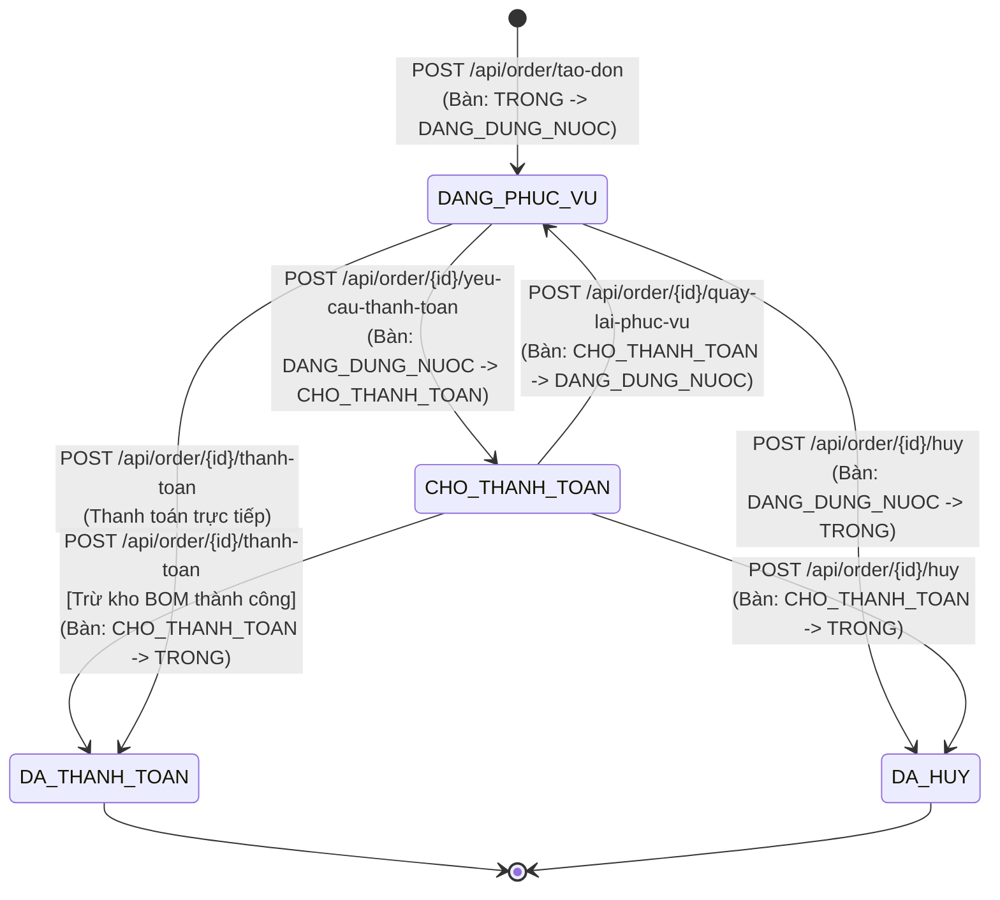

# BÁO CÁO KỸ THUẬT VÀ HIỆN THỰC HỆ THỐNG (SYSTEM TECHNICAL REPORT)
## HỆ THỐNG QUẢN LÝ QUÁN CÀ PHÊ – SANGRIMAR CAFE & LOUNGE
*(Comprehensive Technical Architecture, Implementation & Engineering Report)*

---

> **MÃ HỌC PHẦN:** `502050` – Phân tích và Thiết kế Yêu cầu  
> **KHOA:** Công nghệ Thông tin – Trường Đại học Tôn Đức Thắng  
> **GIẢNG VIÊN HƯỚNG DẪN:** TS. Hồ Thị Linh  
> **TÀI LIỆU:** Báo cáo Đặc tả Kiến trúc Kỹ thuật, Cấu trúc Thư mục, Thành phần Đối tượng Java, Lược đồ 11 Bảng CSDL, Luồng Hoạt động Kỹ thuật, Cơ chế Kiểm soát Đồng thời, An ninh Bảo mật và Kiểm thử Tự động  
> **PHIÊN BẢN HỆ THỐNG:** `2.0.0-RELEASE` (Đồng bộ $100\%$ với mã nguồn `02_SourceCode_WebJava_Prototype`)  
> **NGÀY HOÀN TẤT:** 20/11/2026  
> **ĐƠN VỊ PHÁT TRIỂN:** Nhóm sinh viên thực hiện (Duy – Quý – Đạt)  
>
> **PHÂN BIỆT RÕ RÀNG VỚI CÁC TÀI LIỆU KHÁC TRONG DỰ ÁN:**
> * `BAO_CAO.md`: Báo cáo tổng luận môn học theo mẫu quy chuẩn của Khoa Công nghệ Thông tin (kết hợp lý thuyết kỹ nghệ yêu cầu, khảo sát và mô hình hóa).
> * `BAO_CAO_NGHIEP_VU.md`: Báo cáo chuyên sâu về **Mặt Nghiệp vụ (Business Domain)** – quy trình vận hành F&B, chu trình phục vụ tại bàn, quản trị định mức BOM, kiểm kê hao hụt, SOP 9 bước, chấm công phân ca và quản trị rủi ro kinh doanh.
> * **`BAO_CAO_HE_THONG.md` (TÀI LIỆU NÀY):** Tập trung $100\%$ vào **Mảng Kỹ thuật & Công nghệ (Technical & Software Engineering)** – Ngăn xếp công nghệ, cấu trúc cây thư mục mã nguồn, chi tiết 11 Entity JPA, 21 DTO, 11 Repository, 3 Service, 1 Scheduler, 9 REST Controllers, phân quyền bảo mật 4 tầng, kiểm soát đồng thời (Optimistic/Pessimistic Locking), giao dịch ACID `@Transactional`, lược đồ 11 bảng CSDL MySQL và bộ kiểm thử tích hợp 19 test cases.

---

## MỤC LỤC TỔNG QUAN

1. [TỔNG QUAN CÔNG NGHỆ & NGĂN XẾP PHẦN MỀM (TECH STACK)](#1-tổng-quan-công-nghệ--ngăn-xếp-phần-mềm-tech-stack)
   - 1.1. Mô hình Kiến trúc All-in-One Modular Monolith
   - 1.2. Danh mục Công nghệ & Thư viện sử dụng
   - 1.3. Cấu hình Môi trường Triển khai & Thông số Vận hành
2. [CẤU TRÚC CÂY THƯ MỤC DỰ ÁN & TỔ CHỨC MÃ NGUỒN](#2-cấu-trúc-cây-thư-mục-dự-án--tổ-chức-mã-nguồn)
   - 2.1. Cây thư mục tổng thể Backend & Frontend
   - 2.2. Phân rã trách nhiệm theo từng gói Package Clean Architecture
3. [DANH SÁCH & ĐẶC TẢ CHI TIẾT TẤT CẢ CÁC ĐIỂM CUỐI REST API](#3-danh-sách--đặc-tả-chi-tiết-tất-cả-các-điểm-cuối-rest-api)
   - 3.1. Nhóm API Xác thực & Phiên làm việc (`/api/auth`)
   - 3.2. Nhóm API Quản lý Sơ đồ Bàn (`/api/ban`)
   - 3.3. Nhóm API Thực đơn Đồ uống (`/api/mon-nuoc`)
   - 3.4. Nhóm API Bán hàng POS & Xử lý Đơn hàng (`/api/order`)
   - 3.5. Nhóm API Quản trị Kho & Định mức Pha chế (`/api/kho`)
   - 3.6. Nhóm API Hồ sơ Nhân sự & KPI Doanh số (`/api/nhan-su`)
   - 3.7. Nhóm API Quản lý Danh mục Ca làm việc (`/api/ca-lam`)
   - 3.8. Nhóm API Chấm công Thời gian thực & Chốt ca (`/api/cham-cong`)
   - 3.9. Nhóm API Lập lịch Phân ca Tuần & Đổi ca (`/api/phan-ca`)
4. [KIẾN TRÚC ĐỐI TƯỢNG & MÔ HÌNH DỮ LIỆU KỸ THUẬT](#4-kiến-trúc-đối-tượng--mô-hình-dữ-liệu-kỹ-thuật)
   - 4.1. Tầng Thực thể Dữ liệu (11 JPA Domain Entities)
   - 4.2. Tầng Đối tượng Truyền Dữ liệu (21 DTOs)
   - 4.3. Tầng Truy xuất Dữ liệu (11 Spring Data JPA Repositories)
   - 4.4. Tầng Xử lý Nghiệp vụ Cốt lõi (3 Core Services)
   - 4.5. Tầng Lập lịch Tiến trình Nền (1 Scheduled Task)
   - 4.6. Tầng Điều khiển RESTful & Hạ tầng Hỗ trợ (9 Controllers + 2 Components)
   - 4.7. Lược đồ Cơ sở Dữ liệu Quan hệ Chuẩn 3NF (11 Bảng MySQL 8.0)
5. [CHI TIẾT CÁC LUỒNG HOẠT ĐỘNG & LOGIC KỸ THUẬT LÕI](#5-chi-tiết-các-luồng-hoạt-động--logic-kỹ-thuật-lõi)
   - 5.1. Luồng Bán hàng POS Đa pha & Quản lý Khóa Bàn Trạng thái
   - 5.2. Thuật toán Trừ kho Tự động Ngầm & Khóa Sắp xếp Chống Deadlock
   - 5.3. Cơ chế "Giữ chỗ mềm" (Soft Reservation) & Thuật toán Nút thắt cổ chai
   - 5.4. Cơ chế In Lệnh Quầy Bar theo Độ lệch Delta ($\Delta$)
   - 5.5. Luồng Định giá vốn Bình quân gia quyền (Weighted Average Cost)
   - 5.6. Luồng Chấm công Thời gian thực với `java.time.Clock`
   - 5.7. Luồng Quét & Tự động Chốt ca Quá hạn qua `@Scheduled`
6. [MA TRẬN PHÂN QUYỀN ĐA CẤP (ROLE-BASED ACCESS CONTROL - RBAC)](#6-ma-trận-phân-quyền-đa-cấp-role-based-access-control---rbac)
   - 6.1. Ma trận Phân quyền Kỹ thuật 3 Cấp vai trò
   - 6.2. Hiện thực Kiến trúc Bảo vệ 4 Tầng (4-Layer Defense Architecture)
7. [CÁC CƠ CHẾ BẢO MẬT & KIỂM SOÁT KỸ THUẬT NÂNG CAO](#7-các-cơ-chế-bảo-mật--kiểm-soát-kỹ-thuật-nâng-cao)
   - 7.1. Chống Tấn công Dò quét Mật khẩu (Brute-force Throttling - HTTP 429)
   - 7.2. Bảo mật Thông tin Nhạy cảm & Chống Rò rỉ Dữ liệu
   - 7.3. Kiểm soát Giao dịch Đồng thời (Optimistic & Pessimistic Locking)
   - 7.4. Bảo đảm Tính Bất biến Hóa đơn & Idempotency
   - 7.5. Xử lý Lỗi Ngoại lệ Toàn cục Chuẩn hóa JSON
8. [HIỆN TRẠNG KIỂM THỬ TỰ ĐỘNG & MINH CHỨNG CHẤT LƯỢNG](#8-hiện-trạng-kiểm-thử-tự-động--minh-chứng-chất-lượng)
   - 8.1. Cấu trúc Môi trường Kiểm thử Tích hợp (H2 In-Memory)
   - 8.2. Danh mục 19 Ca Kiểm thử Tự động Chuyên sâu (100% Passed)
9. [HƯỚNG DẪN KHỞI CHẠY, TRIỂN KHAI & BẢO TRÌ HỆ THỐNG](#9-hướng-dẫn-khởi-chạy-triển-khai--bảo-trì-hệ-thống)

---

## 1. TỔNG QUAN CÔNG NGHỆ & NGĂN XẾP PHẦN MỀM (TECH STACK)

### 1.1. Mô hình Kiến trúc All-in-One Modular Monolith
Hệ thống Quản lý Quán Cà phê **Sangrimar Cafe & Lounge** được thiết kế theo kiến trúc **All-in-One Modular Monolith** phân tầng kinh điển (**3-Tier Layered Architecture**). Toàn bộ khối xử lý nghiệp vụ, giao tiếp cơ sở dữ liệu, quản lý phiên và giao diện web SPA được đóng gói gọn gàng trong một tệp thực thi duy nhất (`.jar`), giúp đơn giản hóa tối đa quy trình triển khai tại chỗ (On-Premise) cho quán:

```
+-----------------------------------------------------------------------------------+
|                        TẦNG TRÌNH DIỄN (CLIENT / PRESENTATION TIER)               |
|  - Trình duyệt Web hiện đại (Google Chrome, Microsoft Edge, Mozilla Firefox)      |
|  - HTML5 Ngữ nghĩa · CSS3 Độ tương phản cao Print-friendly (mossary.css)          |
|  - Vanilla JavaScript ES6+ (Fetch API, Async/Await, DOM Injection)                 |
|  - Kiến trúc Topbar Hợp nhất · Thông báo Toast không chặn luồng · In nhiệt K80     |
+-----------------------------------------------------------------------------------+
                                          │ HTTP/1.1 RESTful JSON (Port 8080)
                                          ▼
+-----------------------------------------------------------------------------------+
|                      TẦNG ỨNG DỤNG BACKEND (APPLICATION TIER)                     |
|  [Spring Boot 3.2.5 Core]                                                         |
|  - Máy chủ nhúng: Embedded Apache Tomcat 10.1.20                                  |
|  - Tầng Điều khiển: 9 REST Controllers + PhanQuyenSession (RBAC) + ExceptionAdvice|
|  - Tầng Nghiệp vụ: 3 Core Services (@Transactional, Deadlock-Free Stock Engine)  |
|  - Tầng Lập lịch: ChotCaTuDongScheduler (@Scheduled Cron Runner)                  |
|  - Trừu tượng hóa Thời gian: java.time.Clock Bean (Hỗ trợ Time-travel Test)       |
|  - Tầng Ánh xạ Dữ liệu: Spring Data JPA / Hibernate ORM 6.4.4.Final              |
|  - Bể kết nối CSDL (Connection Pool): HikariCP                                    |
+-----------------------------------------------------------------------------------+
                                          │ Giao thức Mạng JDBC (Port 3306)
                                          ▼
+-----------------------------------------------------------------------------------+
|                       TẦNG CƠ SỞ DỮ LIỆU (DATABASE TIER)                          |
|  - Hệ quản trị: MySQL Server 8.0+ / MariaDB 10.4+ (XAMPP Runtime)                |
|  - Cấu trúc: 11 Bảng Quan hệ Chuẩn hóa 3NF · Engine lưu trữ: InnoDB (ACID)        |
|  - Bảng mã: utf8mb4 · Quy tắc đối chiếu: utf8mb4_unicode_ci                       |
|  - Môi trường Test: H2 In-Memory Database (Chế độ tương thích MySQL)              |
+-----------------------------------------------------------------------------------+
```

---

### 1.2. Danh mục Công nghệ & Thư viện sử dụng

| Phân Vùng Kiến Trúc | Tên Công Nghệ / Thư Viện | Phiên Bản | Mục Đích Sử Dụng Trong Dự Án |
| :--- | :--- | :---: | :--- |
| **Nền tảng Ngôn ngữ** | Java Development Kit (JDK) | OpenJDK 17 LTS / 25 | Cung cấp môi trường chạy máy ảo JVM, hỗ trợ Record, Pattern Matching và API `java.time`. |
| **Khung Backend chính** | Spring Boot Framework | `3.2.5` | Cung cấp khung phát triển vi dịch vụ nguyên khối, tự động cấu hình và quản lý vòng đời Bean. |
| **Giao tiếp REST API** | `spring-boot-starter-web` | `3.2.5` | Xây dựng các Endpoint RESTful, ánh xạ JSON qua Jackson Databind, nhúng máy chủ Tomcat. |
| **Truy xuất CSDL** | `spring-boot-starter-data-jpa` | `3.2.5` | Cung cấp Hibernate 6, trừu tượng hóa truy vấn CRUD, hỗ trợ JPQL và quản lý Transaction. |
| **Kiểm tra Hợp lệ** | `spring-boot-starter-validation` | `3.2.5` | Triển khai Hibernate Validator theo chuẩn JSR-380 (`@NotNull`, `@Size`, `@Min`, `@Pattern`). |
| **Trình điều khiển DB**| `mysql-connector-j` | `8.3.0` | Thư viện JDBC Driver chính thức kết nối từ ứng dụng Java tới máy chủ MySQL/MariaDB. |
| **Bể kết nối DB** | HikariCP | `5.0.1` | Quản lý vòng đời kết nối CSDL tốc độ cao, độ trễ thấp và tối ưu hóa tài nguyên phần cứng. |
| **Tiến trình Nền** | Spring Task Scheduling | `3.2.5` | Kích hoạt tác vụ định kỳ qua chú thích `@EnableScheduling` và `@Scheduled`. |
| **Kiểm thử Backend** | JUnit 5 & AssertJ | `5.10.2` | Viết các ca kiểm thử đơn vị và tích hợp, kiểm tra tính đúng đắn của logic nghiệp vụ. |
| **Môi trường Test DB**| H2 Database Engine | `2.2.224` | CSDL chạy hoàn toàn trên RAM độc lập, tái tạo nhanh dữ liệu test mà không làm bẩn DB MySQL thật. |
| **Giao diện Client** | HTML5 / CSS3 / Vanilla JS | ES6+ | Xây dựng giao diện Web tương tác nhanh, không phụ thuộc framework cồng kềnh, tải trang $< 50\text{ms}$. |
| **Bộ Icon Web** | Bootstrap Icons | `1.11.3` | Cung cấp hệ thống icon đồ họa vector sắc nét (bàn, tiền, người dùng, chuông cảnh báo). |

---

### 1.3. Cấu hình Môi trường Triển khai & Thông số Vận hành

Tệp tin cấu hình chính `src/main/resources/application.properties` thiết lập các tham số kỹ thuật chuẩn:

```properties
# 1. CẤU HÌNH KẾT NỐI CƠ SỞ DỮ LIỆU MYSQL XAMPP
spring.datasource.url=jdbc:mysql://localhost:3306/quan_ly_cafe?useUnicode=true&characterEncoding=UTF-8&serverTimezone=Asia/Ho_Chi_Minh
spring.datasource.username=root
spring.datasource.password=
spring.datasource.driver-class-name=com.mysql.cj.jdbc.Driver

# 2. CẤU HÌNH BỂ KẾT NỐI HIKARICP
spring.datasource.hikari.maximum-pool-size=10
spring.datasource.hikari.minimum-idle=5
spring.datasource.hikari.idle-timeout=300000
spring.datasource.hikari.connection-timeout=20000

# 3. CẤU HÌNH HIBERNATE ORM
spring.jpa.hibernate.ddl-auto=none
spring.jpa.show-sql=false
spring.jpa.properties.hibernate.format_sql=false
spring.jpa.properties.hibernate.dialect=org.hibernate.dialect.MySQLDialect

# 4. CẤU HÌNH MÁY CHỦ TOMCAT & ĐỊNH DẠNG JSON
server.port=8080
server.servlet.context-path=/
spring.jackson.time-zone=Asia/Ho_Chi_Minh
spring.jackson.date-format=yyyy-MM-dd HH:mm:ss
```

---

## 2. CẤU TRÚC CÂY THƯ MỤC DỰ ÁN & TỔ CHỨC MÃ NGUỒN

### 2.1. Cây thư mục tổng thể Backend & Frontend

Toàn bộ dự án được tổ chức khoa học theo chuẩn quy ước Maven Standard Directory Layout:

```
D:\3.1. PTTKYC\CK\02_SourceCode_WebJava_Prototype
├── pom.xml                                  # File cấu hình trung tâm Maven build & dependencies
├── database_mau.sql                         # Kịch bản DDL/DML chuẩn hóa 11 bảng CSDL MySQL v2.0
├── mvnw.cmd & mvnw                          # Trình bao bọc Maven Wrapper độc lập
├── .mvn/wrapper/maven-wrapper.properties    # Định danh phiên bản Maven 3.9.6
│
├── src
│   ├── main
│   │   ├── java/com/cafe
│   │   │   ├── QuanLyCafeApplication.java   # Lớp khởi chạy Spring Boot & Bean java.time.Clock
│   │   │   │
│   │   │   ├── controller                   # TẦNG ĐIỀU KHIỂN & REST API ENDPOINTS
│   │   │   │   ├── BanController.java       # Điều khiển trạng thái sơ đồ bàn (/api/ban)
│   │   │   │   ├── CaLamController.java     # Quản lý danh mục ca làm việc (/api/ca-lam)
│   │   │   │   ├── ChamCongController.java  # Chấm công thời gian thực & chốt ca (/api/cham-cong)
│   │   │   │   ├── DonHangController.java   # Bán hàng POS, in Bar, thanh toán (/api/order)
│   │   │   │   ├── KhoController.java       # Quản trị tồn kho, BOM, kiểm kê & KPI (/api/kho)
│   │   │   │   ├── MonNuocController.java   # Danh mục thực đơn & số ly khả dụng (/api/mon-nuoc)
│   │   │   │   ├── NgoaiLeControllerAdvice.java # Bắt và chuẩn hóa lỗi toàn cục (@RestControllerAdvice)
│   │   │   │   ├── NhanSuController.java    # Quản lý hồ sơ nhân viên & bảng công (/api/nhan-su)
│   │   │   │   ├── PhanCaController.java    # Lập lịch phân ca tuần & đổi ca (/api/phan-ca)
│   │   │   │   ├── PhanQuyenSession.java    # Thành phần trợ giúp bảo mật & kiểm tra phiên RBAC
│   │   │   │   └── XacThucController.java   # Xác thực tài khoản, login, logout (/api/auth)
│   │   │   │
│   │   │   ├── dto                          # TẦNG ĐỐI TƯỢNG TRUYỀN DỮ LIỆU (21 DTOs)
│   │   │   │   ├── BangCongNhanVienDTO.java # Bảng công tổng hợp tháng của nhân viên
│   │   │   │   ├── BangCongThucMonDTO.java  # Dữ liệu định mức BOM kèm giá vốn của món
│   │   │   │   ├── BanHienThiDTO.java       # Dữ liệu trực quan hóa thẻ bàn trên sơ đồ POS
│   │   │   │   ├── CaHomNayDTO.java         # Ca làm việc của nhân viên trong ngày
│   │   │   │   ├── ChamCongDTO.java         # Payload yêu cầu check-in/check-out
│   │   │   │   ├── ChiTietDonHangDTO.java   # Dòng món đặt trong giỏ hàng {maMon, soLuong}
│   │   │   │   ├── ChotCaResponseDTO.java   # Kết quả phản hồi sau khi chốt ca tự động
│   │   │   │   ├── CongThucDTO.java         # Payload định mức thành phần món nước
│   │   │   │   ├── DangNhapDTO.java         # Payload gửi thông tin đăng nhập {username, pass}
│   │   │   │   ├── DashboardKpiDTO.java     # Chỉ số tài chính, doanh thu, COGS, tồn kho
│   │   │   │   ├── DieuChinhChamCongDTO.java# Payload Quản lý sửa giờ công & lý do
│   │   │   │   ├── DinhMucNguyenLieuDTO.java# Dòng định mức chi tiết trong công thức món
│   │   │   │   ├── DoiCaDTO.java            # Payload yêu cầu hoán đổi ca trực
│   │   │   │   ├── DonHangDTO.java          # Payload mở bàn và tạo đơn hàng ban đầu
│   │   │   │   ├── KiemKeKhoDTO.java        # Payload kiểm kê thực tế & xử lý hao hụt
│   │   │   │   ├── MonNuocPosDTO.java       # Thực đơn POS kèm số ly có thể làm khả dụng
│   │   │   │   ├── NhapKhoDTO.java          # Payload nhập thêm nguyên liệu vào kho
│   │   │   │   ├── PhanCaDTO.java           # Payload phân công ca làm việc
│   │   │   │   ├── PhanCaTuanItemDTO.java   # Chi tiết phân ca theo từng ngày trong tuần
│   │   │   │   ├── ThanhToanDTO.java        # Payload xác nhận thanh toán & phương thức TT
│   │   │   │   └── TopMonBanChayDTO.java    # Dữ liệu thống kê Top 5 món bán chạy nhất
│   │   │   │
│   │   │   ├── entity                       # TẦNG THỰC THỂ DỮ LIỆU JPA (11 ENTITIES)
│   │   │   │   ├── Ban.java                 # Thực thể Bàn (Trạng thái: TRONG, DANG_DUNG_NUOC, CHO_THANH_TOAN)
│   │   │   │   ├── CaLam.java               # Thực thể Ca làm việc (Giờ bắt đầu, kết thúc, hệ số lương)
│   │   │   │   ├── ChamCong.java            # Thực thể Chấm công (Số giờ làm, giờ công quy đổi, đi trễ)
│   │   │   │   ├── ChiTietHoaDon.java       # Dòng chi tiết hóa đơn (Số lượng đặt, số lượng đã in Bar)
│   │   │   │   ├── CongThuc.java            # Thực thể Định mức công thức pha chế BOM
│   │   │   │   ├── HoaDon.java              # Thực thể Hóa đơn (@Version Optimistic Lock)
│   │   │   │   ├── LichSuKho.java           # Bảng thứ 11: Nhật ký truy vết biến động kho
│   │   │   │   ├── MonNuoc.java             # Thực thể Món nước (Thực đơn đồ uống)
│   │   │   │   ├── NguyenLieu.java          # Thực thể Nguyên liệu tồn kho & Đơn giá WAC
│   │   │   │   ├── NhanVien.java            # Thực thể Nhân sự & Tài khoản phân quyền
│   │   │   │   └── PhanCa.java              # Thực thể Lập lịch phân ca trực
│   │   │   │
│   │   │   ├── repository                   # TẦNG TRUY XUẤT SPRING DATA JPA (11 REPOSITORIES)
│   │   │   │   ├── BanRepository.java       # Truy vấn & khóa bi quan trạng thái Bàn
│   │   │   │   ├── CaLamRepository.java     # Truy vấn danh mục ca làm
│   │   │   │   ├── ChamCongRepository.java  # Truy vấn chấm công, tìm người quên check-out
│   │   │   │   ├── ChiTietHoaDonRepository.java # Truy vấn dòng món theo hóa đơn
│   │   │   │   ├── CongThucRepository.java  # Truy vấn định mức BOM theo món
│   │   │   │   ├── HoaDonRepository.java    # Khóa ghi hóa đơn, kiểm tra Idempotency
│   │   │   │   ├── LichSuKhoRepository.java # Truy xuất sổ cái biến động kho
│   │   │   │   ├── MonNuocRepository.java   # Lọc thực đơn theo trạng thái đang bán
│   │   │   │   ├── NguyenLieuRepository.java# Khóa bi quan nguyên liệu, lọc cảnh báo hết
│   │   │   │   ├── NhanVienRepository.java  # Xác thực đăng nhập và lọc vai trò
│   │   │   │   └── PhanCaRepository.java    # Truy vấn phân ca, tìm ca chưa chấm công
│   │   │   │
│   │   │   ├── scheduler                    # TẦNG TIẾN TRÌNH LẬP LỊCH NỀN
│   │   │   │   └── ChotCaTuDongScheduler.java # @Scheduled cron quét chốt ca quá hạn
│   │   │   │
│   │   │   └── service                      # TẦNG NGHIỆP VỤ CỐT LÕI (@Service)
│   │   │       ├── DonHangService.java      # Quản lý bán hàng, in Bar, khóa thanh toán, tính giá
│   │   │       ├── KhoService.java          # Trừ kho BOM ngầm, tính WAC, kiểm kê, Dashboard KPI
│   │   │       └── NhanSuService.java       # Xác thực, chấm công, tính giờ công quy đổi, đổi ca
│   │   │
│   │   └── resources
│   │       ├── application.properties       # Cấu hình Datasource MySQL, Hibernate, Jackson
│   │       └── static                       # TÀI NGUYÊN GIAO DIỆN CLIENT PHÍA TRÌNH DUYỆT
│   │           ├── index.html               # Màn hình Đăng nhập hệ thống (có 3 nút Quick-fill)
│   │           ├── banhang.html             # Màn hình Bán hàng POS, Sơ đồ bàn & 3 mẫu phiếu in
│   │           ├── kho.html                 # Màn hình Quản trị Kho, Định mức BOM & KPI Dashboard
│   │           ├── nhansu.html              # Màn hình Quản lý Nhân sự & Chấm công (2 Chế độ)
│   │           ├── favicon.ico              # Icon tách cà phê đại diện Sangrimar
│   │           ├── css
│   │           │   └── mossary.css          # Bảng kiểu CSS tông sáng tối ưu in ấn A4 (Print-friendly)
│   │           └── js
│   │               ├── dung-chung.js        # Module tiện ích chung: Topbar, Session Guard, Toasts
│   │               ├── banhang-page.js      # Kịch bản POS: Mở bàn, In Bar, Khóa thanh toán, VietQR
│   │               ├── kho-page.js          # Kịch bản Kho: Bảng tồn, Nhập hàng WAC, Kiểm kê, KPI
│   │               └── nhansu-page.js       # Kịch bản Nhân sự: Phân ca tuần, Check-in/out thời gian thực
│   │
│   └── test                                 # TẦNG KIỂM THỬ TỰ ĐỘNG CHUYÊN SÂU
│       ├── java/com/cafe
│       │   ├── DonHangIntegrationTest.java  # 5 ca kiểm thử tích hợp POS, Soft Reservation, RBAC
│       │   ├── KhoKpiIntegrationTest.java   # 6 ca kiểm thử Nhập kho WAC, Trừ kho BOM, Deadlock
│       │   └── NhanSuChamCongIntegrationTest.java # 8 ca kiểm thử Chấm công, Du di 15p, Chốt ca tự động
│       └── resources
│           └── application-test.properties  # Cấu hình CSDL H2 In-Memory chạy kiểm thử độc lập
```

---

## 3. DANH SÁCH & ĐẶC TẢ CHI TIẾT TẤT CẢ CÁC ĐIỂM CUỐI REST API

Toàn bộ hệ thống cung cấp **32 điểm cuối REST API chuẩn hóa**, phân chia thành 9 phân hệ chức năng:

### 3.1. Nhóm API Xác thực & Phiên làm việc (`XacThucController` - `/api/auth`)
* `POST /api/auth/login`: Tiếp nhận `DangNhapDTO`, đối chiếu tài khoản trong bảng `nhan_vien`. Trả về `NhanVien` (ẩn mật khẩu) và lưu thông tin vào `HttpSession`. Có cơ chế chống Brute-force: sai 5 lần liên tiếp sẽ trả về `HTTP 429 Too Many Requests`.
* `GET /api/auth/me`: Kiểm tra thông tin phiên làm việc hiện tại từ `HttpSession`. Trả về `HTTP 200` kèm thông tin nhân sự hoặc `HTTP 401 Unauthorized` nếu chưa đăng nhập.
* `POST /api/auth/logout`: Hủy bỏ hoàn toàn phiên làm việc phía máy chủ (`session.invalidate()`), trả về thông điệp đăng xuất thành công.

### 3.2. Nhóm API Quản lý Sơ đồ Bàn (`BanController` - `/api/ban`)
* `GET /api/ban`: Lấy danh sách toàn bộ 15 bàn vật lý kèm trạng thái hiện tại.
* `GET /api/ban/so-do`: Trả về danh sách `BanHienThiDTO` tối ưu cho giao diện POS, bao gồm: tên bàn, vị trí, số ghế, trạng thái (`TRONG`, `DANG_DUNG_NUOC`, `CHO_THANH_TOAN`), mã hóa đơn hiện tại, tổng tiền tạm tính và cờ báo `yeuCauThanhToan`.
* `GET /api/ban/{id}`: Tra cứu chi tiết một bàn theo mã định danh.

### 3.3. Nhóm API Thực đơn Đồ uống (`MonNuocController` - `/api/mon-nuoc`)
* `GET /api/mon-nuoc`: Lấy danh sách toàn bộ thực đơn đang hoạt động (`DANG_BAN`).
* `GET /api/mon-nuoc/pos`: **API Thực đơn Thông minh:** Trả về danh sách `MonNuocPosDTO`. Điểm đặc biệt là hệ thống tự động bóc tách tồn kho của 13 nguyên vật liệu để tính toán trường `soLyCoTheLam` (Số ly có thể làm) theo nguyên lý Thắt cổ chai, tuyệt đối không làm lộ số lượng tồn kho gốc cho nhân viên phục vụ.

### 3.4. Nhóm API Bán hàng POS & Xử lý Đơn hàng (`DonHangController` - `/api/order`)
* `POST /api/order/tao-don`: Phục vụ mở bàn và đặt món. Payload `DonHangDTO(maBan, chiTiets)`. Hệ thống kiểm tra điều kiện bàn trống, kiểm tra tồn kho khả dụng, tạo bản ghi `HoaDon` trạng thái `DANG_PHUC_VU`, chuyển trạng thái bàn sang `DANG_DUNG_NUOC`, lưu các dòng `chi_tiet_hoa_don` với `soLuongDaInBar = 0`.
* `GET /api/order/{id}`: Lấy chi tiết toàn bộ hóa đơn kèm các dòng món uống.
* `GET /api/order/theo-ban/{maBan}`: Tra cứu đơn hàng đang phục vụ của một bàn cụ thể.
* `PUT /api/order/{id}/mon`: Cập nhật danh sách món (gọi thêm món). Bị chặn ngay lập tức với mã `HTTP 409 Conflict` nếu bàn đang ở trạng thái `CHO_THANH_TOAN`.
* `POST /api/order/{id}/yeu-cau-thanh-toan`: Phục vụ bấm yêu cầu tính tiền. Chuyển trạng thái hóa đơn và bàn sang `CHO_THANH_TOAN` (màu Vàng), khóa quyền sửa món.
* `POST /api/order/{id}/quay-lai-phuc-vu`: Khách đổi ý gọi thêm. Chuyển trạng thái bàn và hóa đơn từ `CHO_THANH_TOAN` trở về `DANG_DUNG_NUOC` (màu Xanh lá).
* `POST /api/order/{id}/in-bar`: Xuất lệnh pha chế cho Quầy Bar. Hệ thống tính độ lệch $\Delta = \text{soLuong} - \text{soLuongDaInBar}$, cập nhật `soLuongDaInBar = soLuong` và trả về danh sách món mới cần làm.
* `GET /api/order/{id}/in-tam-tinh`: Thu ngân in Phiếu Tạm Tính. Trả về cấu trúc hóa đơn kèm tiền gốc, chiết khấu, tổng cần thu và chuỗi dữ liệu tạo mã VietQR động.
* `POST /api/order/{id}/thanh-toan`: Thu ngân chốt bill. Payload `ThanhToanDTO(phuongThucTT, tienKhachDua, chietKhau, ...)`. Hệ thống chạy giao dịch nguyên tử: trừ kho BOM, ghi nhật ký `XUAT_BAN_HANG`, cập nhật hóa đơn `DA_THANH_TOAN` và giải phóng bàn về `TRONG`.
* `POST /api/order/{id}/huy`: Hủy đơn hàng. Chỉ cho phép `THU_NGAN` hoặc `QUAN_LY` thực hiện, yêu cầu nhập lý do hủy, giải phóng bàn về `TRONG` và không phát sinh trừ kho.

### 3.5. Nhóm API Quản trị Kho & Định mức Pha chế (`KhoController` - `/api/kho`)
* `GET /api/kho/nguyen-lieu`: Quản lý xem danh mục tồn kho 13 nguyên liệu (bảo vệ quyền `QUAN_LY`).
* `POST /api/kho/nhap-kho`: Payload `NhapKhoDTO`. Cộng dồn số lượng tồn và tự động tính lại đơn giá vốn theo công thức Bình quân gia quyền (WAC), ghi bản ghi `NHAP_KHO` vào sổ nhật ký.
* `POST /api/kho/kiem-ke`: Payload `KiemKeKhoDTO`. Bắt buộc nhập lý do điều chỉnh khi có chênh lệch tồn thực tế, cập nhật lại số dư kho và ghi nhận bản ghi `KIEM_KE_HAO_HUT`.
* `GET /api/kho/lich-su`: Tra cứu sổ nhật ký biến động kho (`lich_su_kho`) có hỗ trợ lọc theo khoảng thời gian và loại giao dịch.
* `GET /api/kho/bang-cong-thuc`: Lấy danh sách định mức BOM toàn bộ 12 món đồ uống kèm giá vốn/ly, biên lợi nhuận và số ly khả dụng.
* `GET /api/kho/cong-thuc/{maMon}` & `POST /api/kho/cong-thuc`: Tra cứu và cập nhật định mức BOM cho từng món nước.
* `GET /api/kho/dashboard`: Trả về dữ liệu `DashboardKpiDTO` theo 4 kỳ lọc: `HOM_NAY`, `BAY_NGAY`, `THANG_NAY`, `TAT_CA`.
* `GET /api/kho/sap-het`: Trả về danh sách các nguyên vật liệu đang có số tồn $\le$ mức tồn tối thiểu để kích hoạt huy hiệu cảnh báo trên Topbar.

### 3.6. Nhóm API Hồ sơ Nhân sự & KPI Doanh số (`NhanSuController` - `/api/nhan-su`)
* `GET /api/nhan-su/nhan-vien`: Lấy danh sách nhân sự (chỉ dành cho `QUAN_LY`).
* `POST /api/nhan-su/nhan-vien`: Tạo hồ sơ nhân viên mới.
* `PUT /api/nhan-su/nhan-vien/{id}`: Cập nhật thông tin nhân viên hoặc chuyển trạng thái `DA_NGHI`. Có cơ chế bảo vệ: không cho phép khóa tài khoản Quản lý cuối cùng.
* `GET /api/nhan-su/kpi-hom-nay`: Thống kê nhanh tổng nhân sự đi làm và tỷ lệ hoàn thành ca trong ngày.
* `GET /api/nhan-su/bang-cong-thang`: Xuất bảng tổng hợp chấm công tháng của toàn bộ nhân viên (tổng giờ làm, giờ công quy đổi, số lần đi trễ, số lần về sớm).

### 3.7. Nhóm API Quản lý Danh mục Ca làm việc (`CaLamController` - `/api/ca-lam`)
* `GET /api/ca-lam`: Lấy thông tin 3 ca làm việc tiêu chuẩn (Sáng, Chiều, Tối kèm hệ số lương).

### 3.8. Nhóm API Chấm công Thời gian thực & Chốt ca (`ChamCongController` - `/api/cham-cong`)
* `POST /api/cham-cong/check-in`: Nhân viên tự chấm công vào ca. Kiểm tra phân ca hợp lệ hôm nay, kiểm tra cửa sổ check-in $[\text{start} - 30p, \text{end})$, áp dụng quy tắc du di 15 phút để gán trạng thái `DUNG_GIO` hoặc `DI_TRE`.
* `POST /api/cham-cong/check-out`: Nhân viên kết thúc ca. Tính toán giờ làm thực tế, phát hiện về sớm $> 15$ phút (`VE_SOM` hoặc `DI_TRE_VE_SOM`), nhân hệ số ca làm ra `gioCongQuyDoi`.
* `GET /api/cham-cong/hom-nay`: Lấy danh sách ca làm việc và trạng thái chấm công hôm nay của cá nhân đang đăng nhập.
* `GET /api/cham-cong/lich-su`: Xem lịch sử chấm công cá nhân hoặc toàn bộ quán.
* `PUT /api/cham-cong/{id}/dieu-chinh`: Quản lý sửa giờ công và trạng thái khi nhân viên có giải trình. Bắt buộc nhập `lyDoDieuChinh`, lưu kiểm toán `nguoiDieuChinh` và `thoiGianDieuChinh`.
* `POST /api/cham-cong/chot-ca`: Kích hoạt thủ công tiến trình chotCaTuDong (dành cho Quản lý).

### 3.9. Nhóm API Lập lịch Phân ca Tuần & Đổi ca (`PhanCaController` - `/api/phan-ca`)
* `GET /api/phan-ca/tuan`: Lấy lưới phân ca 7 ngày trong tuần. Tự động kiểm tra quy tắc cân bằng nhân sự và gắn cờ `thieuThuNgan = true` nếu ca thiếu vai trò thu ngân.
* `POST /api/phan-ca`: Phân ca cho nhân viên theo ngày và ca làm.
* `GET /api/phan-ca/ca-nhan`: Lịch trực cá nhân của nhân viên đang đăng nhập.
* `POST /api/phan-ca/doi-ca`: Nhân viên yêu cầu đổi ca trực. Chỉ cho phép khi ca chưa diễn ra và chưa phát sinh chấm công.

---

## 4. KIẾN TRÚC ĐỐI TƯỢNG & MÔ HÌNH DỮ LIỆU KỸ THUẬT

### 4.1. Tầng Thực thể Dữ liệu (11 JPA Domain Entities)

Tất cả 11 thực thể được ánh xạ ORM chuẩn JPA/Hibernate vào các bảng CSDL tương ứng:

```
+------------------------------------------------------------------------------------------------------------------------------------+
|                                               SƠ ĐỒ CẤU TRÚC 11 THỰC THỂ DỮ LIỆU JPA                                               |
+------------------------------------------------------------------------------------------------------------------------------------+
  [Phân hệ Bán hàng & Thực đơn]
  * Ban.java                : Bàn vật lý (maBan [PK], tenBan [UK], viTri, soGhe, trangThai)
  * MonNuoc.java            : Thực đơn đồ uống (maMon [PK], tenMon [UK], danhMuc, donGia, hinhAnh, trangThai)
  * HoaDon.java             : Hóa đơn bán lẻ (maHoaDon [PK], ban [FK], nhanVien [FK], nhanVienThuNgan [FK],
                              thoiGianTao, thoiGianThanhToan, loaiDon, tongTienThanhToan, phienBan [@Version], ...)
  * ChiTietHoaDon.java      : Dòng món trong đơn (maCTHD [PK], hoaDon [FK], monNuoc [FK], soLuong, soLuongDaInBar, donGiaBan)

  [Phân hệ Kho & Định mức Pha chế]
  * NguyenLieu.java         : Tồn kho nguyên liệu (maNL [PK], tenNL [UK], donViTinh, soLuongTon, mucTonToiThieu, donGiaNhap)
  * CongThuc.java           : Định mức BOM (maCongThuc [PK], monNuoc [FK], nguyenLieu [FK], dinhMuc, ghiChu)
  * LichSuKho.java [BẢNG 11]: Sổ nhật ký kho (maGD [PK], nguyenLieu [FK], nhanVien [FK], hoaDon [FK],
                              loaiGD [NHAP_KHO/XUAT_BAN_HANG/KIEM_KE_HAO_HUT], soLuongThayDoi, tonTruoc, tonSau, thoiGian)

  [Phân hệ Nhân sự, Ca làm & Chấm công]
  * NhanVien.java           : Nhân sự & Tài khoản (maNV [PK], tenDangNhap [UK], matKhau, vaiTro, trangThai)
  * CaLam.java              : Danh mục ca (maCa [PK], tenCa, gioBatDau, gioKetThuc, heSoLuong)
  * PhanCa.java             : Lịch trực tuần (maPhanCa [PK], nhanVien [FK], caLam [FK], ngayLam, ghiChu)
  * ChamCong.java           : Nhật ký chấm công (maChamCong [PK], phanCa [FK], nhanVien [FK], caLam [FK], ngayLam,
                              gioCheckIn, gioCheckOut, soGioLam, gioCongQuyDoi, soPhutTre, trangThai, nguoiDieuChinh [FK])
+------------------------------------------------------------------------------------------------------------------------------------+
```

---

### 4.2. Tầng Đối tượng Truyền Dữ liệu (21 DTOs)

Để bảo đảm tính đóng gói và an toàn dữ liệu, hệ thống không bao giờ để lộ trực tiếp thực thể JPA ra ngoài tầng giao diện mà luôn thông qua **21 DTOs chuyên biệt**:

| Tên Lớp DTO | Gói Package | Hướng Dữ Liệu | Mục Đích Kỹ Thuật & Nghiệp Vụ Cụ Thể |
| :--- | :--- | :---: | :--- |
| `DangNhapDTO` | `com.cafe.dto` | Request $\rightarrow$ Server | Chứa thông tin đăng nhập: `{tenDangNhap, matKhau}`. |
| `DonHangDTO` | `com.cafe.dto` | Request $\rightarrow$ Server | Chứa thông tin mở bàn: `{maBan, loaiDon, chiTiets, ghiChu}`. |
| `ChiTietDonHangDTO`| `com.cafe.dto` | Request $\rightarrow$ Server | Chi tiết từng món trong giỏ hàng: `{maMon, soLuong, ghiChu}`. |
| `ThanhToanDTO` | `com.cafe.dto` | Request $\rightarrow$ Server | Thông tin thu tiền: `{phuongThucTT, tienKhachDua, chietKhau, maThamChieu}`. |
| `MonNuocPosDTO` | `com.cafe.dto` | Server $\rightarrow$ Response| Trả về thực đơn POS, tính toán sẵn trường `soLyCoTheLam`. |
| `BanHienThiDTO` | `com.cafe.dto` | Server $\rightarrow$ Response| Trực quan hóa thẻ bàn: màu viền, số tiền tạm tính, mã đơn hiện tại. |
| `NhapKhoDTO` | `com.cafe.dto` | Request $\rightarrow$ Server | Dữ liệu nhập hàng: `{maNL, soLuong, donGiaNhap, nhaCungCap}`. |
| `KiemKeKhoDTO` | `com.cafe.dto` | Request $\rightarrow$ Server | Dữ liệu kiểm kê: `{maNL, soLuongThucTe, lyDo}`. |
| `CongThucDTO` | `com.cafe.dto` | Request $\rightarrow$ Server | Định mức công thức đơn lẻ: `{maMon, maNL, dinhMuc}`. |
| `BangCongThucMonDTO`| `com.cafe.dto` | Server $\rightarrow$ Response| Trả về toàn bộ định mức của món, kèm giá vốn COGS và biên lợi nhuận. |
| `DinhMucNguyenLieuDTO`| `com.cafe.dto`| Shared DTO | Dòng thành phần nguyên liệu chi tiết trong công thức món. |
| `ChamCongDTO` | `com.cafe.dto` | Request $\rightarrow$ Server | Dữ liệu check-in/out: `{maCa, ghiChu}`. |
| `DieuChinhChamCongDTO`| `com.cafe.dto`| Request $\rightarrow$ Server | Quản lý sửa công: `{gioCheckIn, gioCheckOut, trangThai, lyDoDieuChinh}`. |
| `PhanCaDTO` | `com.cafe.dto` | Request $\rightarrow$ Server | Dữ liệu phân ca: `{maNV, maCa, ngayLam, ghiChu}`. |
| `PhanCaTuanItemDTO`| `com.cafe.dto` | Server $\rightarrow$ Response| Hiển thị lưới lịch ca 7 ngày, kèm cờ cảnh báo `thieuThuNgan`. |
| `DoiCaDTO` | `com.cafe.dto` | Request $\rightarrow$ Server | Yêu cầu đổi ca: `{maPhanCa, maNVNhan, lyDo}`. |
| `BangCongNhanVienDTO`| `com.cafe.dto`| Server $\rightarrow$ Response| Tổng hợp công tháng: tổng giờ thực, giờ công quy đổi, số lần đi trễ. |
| `DashboardKpiDTO` | `com.cafe.dto` | Server $\rightarrow$ Response| Số liệu KPI: Doanh thu thuần, COGS, tiền mặt, chuyển khoản, hao hụt. |
| `TopMonBanChayDTO`| `com.cafe.dto` | Server $\rightarrow$ Response| Thống kê xếp hạng Top 5 món bán chạy nhất. |
| `CaHomNayDTO` | `com.cafe.dto` | Server $\rightarrow$ Response| Danh sách ca trực và trạng thái chấm công của nhân sự hôm nay. |
| `ChotCaResponseDTO`| `com.cafe.dto` | Server $\rightarrow$ Response| Kết quả tiến trình chốt ca: `{soCaChot, soVang, soQuenCheckOut}`. |

---

### 4.3. Tầng Truy xuất Dữ liệu (11 Spring Data JPA Repositories)

Các Interface Repository kế thừa `JpaRepository<T, ID>` và được bổ sung các phương thức truy vấn tối ưu:
* **`BanRepository`:** `findByTrangThai(String trangThai)`, `findByIdForUpdate(Integer maBan)` (Khóa bi quan `PESSIMISTIC_WRITE` khi mở bàn).
* **`HoaDonRepository`:** `timDonDangPhucVuCuaBan(@Param("maBan") Integer maBan)`, `timTheoMaHoaDonDayDu(@Param("id") Integer id)` (Sử dụng `JOIN FETCH` bốc trọn vẹn `chiTietHoaDons` và `ban` trong duy nhất $1$ câu lệnh SQL, triệt tiêu hoàn toàn vấn nạn $N+1$ Query).
* **`ChiTietHoaDonRepository`:** `findByHoaDon_MaHoaDon(Integer maHoaDon)`.
* **`NguyenLieuRepository`:** `findByIdForUpdate(Integer maNL)` (Khóa bi quan chống tranh chấp trừ kho đồng thời), `timNguyenLieuSapHet()`.
* **`CongThucRepository`:** `findByMonNuoc_MaMon(Integer maMon)`, `findByNguyenLieu_MaNL(Integer maNL)`.
* **`LichSuKhoRepository`:** `timLichSuTheoKhoangThoiGian(@Param("tuNgay") LocalDateTime tuNgay, @Param("denNgay") LocalDateTime denNgay)`.
* **`NhanVienRepository`:** `findByTenDangNhap(String tenDangNhap)`, `countByVaiTroAndTrangThai(String vaiTro, String trangThai)`.
* **`CaLamRepository`:** Truy vấn 3 ca làm việc tiêu chuẩn.
* **`PhanCaRepository`:** `findByNhanVien_MaNVAndNgayLam(Integer maNV, LocalDate ngayLam)`, `timPhanCaChuaChamCongTheoNgay(@Param("maCa") Integer maCa, @Param("ngayLam") LocalDate ngayLam)`.
* **`ChamCongRepository`:** `findByNhanVien_MaNVAndCaLam_MaCaAndNgayLam(...)`, `timChamCongQuenCheckOut(@Param("maCa") Integer maCa, @Param("ngayLam") LocalDate ngayLam)`.
* **`MonNuocRepository`:** `findByTrangThai(String trangThai)`.

---

### 4.4. Tầng Xử lý Nghiệp vụ Cốt lõi (3 Core Services)

1. **`DonHangService.java`:**
   - Quản lý toàn bộ chu trình phục vụ bàn POS.
   - Xử lý mở bàn, đặt món, in Bar, yêu cầu thanh toán, hủy đơn.
   - Điều phối phương thức `thanhToanDonHang()` được bọc trong `@Transactional(isolation = Isolation.READ_COMMITTED)`.
   - Tính toán doanh số, phân loại nguồn tiền mặt vs VietQR và xếp hạng Top 5 món bán chạy.
2. **`KhoService.java`:**
   - Quản trị nghiệp vụ kho vật lý và tính toán định mức công thức BOM.
   - Hiện thực phương thức `truKhoTuDong()`: bóc tách công thức, kiểm tra số dư, trừ kho và ghi sổ `lich_su_kho`.
   - Hiện thực thuật toán **Sắp xếp khóa chống Deadlock** bằng `TreeMap<Integer, BigDecimal>`.
   - Tính giá vốn Bình quân gia quyền WAC trong `nhapKho()`.
   - Xử lý cân bằng tồn kho và ghi nhận hao hụt trong `kiemKeKho()`.
   - Tính toán trường `soLyCoTheLam` theo nguyên lý thắt cổ chai phục vụ POS.
3. **`NhanSuService.java`:**
   - Xác thực người dùng, bảo vệ mật khẩu và quản lý hồ sơ nhân viên.
   - Hiện thực logic chấm công thời gian thực (`checkIn`, `checkOut`), tự động phát hiện đi trễ, về sớm.
   - Nhúng đối tượng trừu tượng `java.time.Clock` để kiểm soát thời gian chính xác trong môi trường kiểm thử.
   - Hiện thực thuật toán `chotCaTuDong()`: quét và đánh dấu `VANG`, `QUEN_CHECK_OUT`.
   - Xử lý phân ca tuần, kiểm tra ràng buộc cân bằng nhân sự và hoán đổi ca trực.

---

### 4.5. Tầng Lập lịch Tiến trình Nền (1 Scheduled Task)

* **`ChotCaTuDongScheduler.java`:**
  - Được cấu hình bằng chú thích `@Component`.
  - Phương thức `tuDongChotCaVaGhiNhanVang()` được gắn chú thích:
    ```java
    @Scheduled(cron = "0 */15 * * * *") // Định kỳ kích hoạt mỗi 15 phút một lần
    public void tuDongChotCaVaGhiNhanVang() {
        nhanSuService.chotCaTuDong();
    }
    ```
  - Nhiệm vụ: Tự động rà soát các ca làm việc đã kết thúc quá 30 phút mà nhân viên chưa check-in hoặc chưa check-out, tự động đóng ca và ghi nhận vào CSDL mà không cần con người can thiệp thủ công.

---

### 4.6. Tầng Điều khiển RESTful & Hạ tầng Hỗ trợ (9 Controllers + 2 Components)

* **9 REST Controllers:** Tiếp nhận yêu cầu HTTP từ trình duyệt, giải mã JSON thành DTO, chuyển tiếp cho tầng Service xử lý và bao bọc kết quả trả về trong đối tượng `ResponseEntity<?>`.
* **`PhanQuyenSession.java`:** Đóng vai trò là thành phần cổng bảo vệ (**Route Guard / Security Helper**). Cung cấp các phương thức tiện ích: `userId(session)`, `role(session)`, `requireLogin(session)`, `requireThuNganHoacQuanLy(session)`, `requireQuanLy(session)`. Nếu vi phạm quyền hạn, phương thức lập tức ném ra ngoại lệ `ResponseStatusException(HttpStatus.FORBIDDEN, "Tu choi truy cap")`.
* **`NgoaiLeControllerAdvice.java`:** Đóng vai trò là bộ đón bắt lỗi tập trung (**Global Exception Handler**), gắn chú thích `@RestControllerAdvice`. Đón bắt toàn bộ các ngoại lệ phát sinh trong hệ thống (Validation, Concurrency, EntityNotFound, BusinessViolation) và trả về cấu trúc JSON đồng nhất:
  ```json
  {
    "timestamp": "2026-11-20T08:30:00",
    "status": 400,
    "error": "Bad Request",
    "message": "Khong du nguyen lieu pha che trong kho!",
    "path": "/api/order/45/thanh-toan"
  }
  ```

---

### 4.7. Lược đồ Cơ sở Dữ liệu Quan hệ Chuẩn 3NF (11 Bảng MySQL 8.0)

Cơ sở dữ liệu được tổ chức chuẩn hóa bậc 3 (3NF) gồm **11 bảng quan hệ toàn vẹn**:

```sql
-- 1. BẢNG NHÂN VIÊN & TÀI KHOẢN HỆ THỐNG
CREATE TABLE nhan_vien (
    ma_nv INT AUTO_INCREMENT PRIMARY KEY,
    ho_ten VARCHAR(100) NOT NULL,
    so_dien_thoai VARCHAR(20),
    ten_dang_nhap VARCHAR(50) NOT NULL UNIQUE,
    mat_khau VARCHAR(255) NOT NULL,
    vai_tro VARCHAR(20) NOT NULL CHECK (vai_tro IN ('QUAN_LY', 'THU_NGAN', 'PHUC_VU')),
    trang_thai VARCHAR(20) NOT NULL DEFAULT 'DANG_LAM' CHECK (trang_thai IN ('DANG_LAM', 'DA_NGHI'))
) ENGINE=InnoDB DEFAULT CHARSET=utf8mb4 COLLATE=utf8mb4_unicode_ci;

-- 2. BẢNG DANH MỤC CA LÀM VIỆC
CREATE TABLE ca_lam (
    ma_ca INT AUTO_INCREMENT PRIMARY KEY,
    ten_ca VARCHAR(50) NOT NULL,
    gio_bat_dau TIME NOT NULL,
    gio_ket_thuc TIME NOT NULL,
    he_so_luong DECIMAL(3,2) NOT NULL DEFAULT 1.00
) ENGINE=InnoDB DEFAULT CHARSET=utf8mb4 COLLATE=utf8mb4_unicode_ci;

-- 3. BẢNG PHÂN CÔNG CA LÀM VIỆC THEO TUẦN
CREATE TABLE phan_ca (
    ma_phan_ca INT AUTO_INCREMENT PRIMARY KEY,
    ma_nv INT NOT NULL,
    ma_ca INT NOT NULL,
    ngay_lam DATE NOT NULL,
    ghi_chu VARCHAR(255),
    UNIQUE KEY uk_phan_ca_nv_ngay_ca (ma_nv, ngay_lam, ma_ca),
    CONSTRAINT fk_phan_ca_nv FOREIGN KEY (ma_nv) REFERENCES nhan_vien(ma_nv),
    CONSTRAINT fk_phan_ca_ca FOREIGN KEY (ma_ca) REFERENCES ca_lam(ma_ca)
) ENGINE=InnoDB DEFAULT CHARSET=utf8mb4 COLLATE=utf8mb4_unicode_ci;

-- 4. BẢNG NHẬT KÝ CHẤM CÔNG THỜI GIAN THỰC
CREATE TABLE cham_cong (
    ma_cham_cong INT AUTO_INCREMENT PRIMARY KEY,
    ma_phan_ca INT NULL,
    ma_nv INT NOT NULL,
    ma_ca INT NOT NULL,
    ngay_lam DATE NOT NULL,
    gio_check_in DATETIME NULL,
    gio_check_out DATETIME NULL,
    so_phut_tre INT NOT NULL DEFAULT 0,
    so_phut_ve_som INT NOT NULL DEFAULT 0,
    so_gio_lam DECIMAL(4,2) NOT NULL DEFAULT 0.00,
    gio_cong_quy_doi DECIMAL(4,2) NOT NULL DEFAULT 0.00,
    trang_thai VARCHAR(30) NOT NULL CHECK (trang_thai IN ('DUNG_GIO', 'DI_TRE', 'VE_SOM', 'DI_TRE_VE_SOM', 'VANG', 'QUEN_CHECK_OUT')),
    ghi_chu VARCHAR(255),
    nguoi_dieu_chinh INT NULL,
    ly_do_dieu_chinh VARCHAR(255),
    thoi_gian_dieu_chinh DATETIME NULL,
    UNIQUE KEY uk_cham_cong_nv_ca_ngay (ma_nv, ma_ca, ngay_lam),
    CONSTRAINT fk_cham_cong_phan_ca FOREIGN KEY (ma_phan_ca) REFERENCES phan_ca(ma_phan_ca),
    CONSTRAINT fk_cham_cong_nv FOREIGN KEY (ma_nv) REFERENCES nhan_vien(ma_nv),
    CONSTRAINT fk_cham_cong_ca FOREIGN KEY (ma_ca) REFERENCES ca_lam(ma_ca),
    CONSTRAINT fk_cham_cong_nguoi_dc FOREIGN KEY (nguoi_dieu_chinh) REFERENCES nhan_vien(ma_nv)
) ENGINE=InnoDB DEFAULT CHARSET=utf8mb4 COLLATE=utf8mb4_unicode_ci;

-- 5. BẢNG SƠ ĐỒ BÀN VẬT LÝ
CREATE TABLE ban (
    ma_ban INT AUTO_INCREMENT PRIMARY KEY,
    ten_ban VARCHAR(50) NOT NULL UNIQUE,
    vi_tri VARCHAR(100),
    so_ghe INT NOT NULL DEFAULT 4,
    trang_thai VARCHAR(30) NOT NULL DEFAULT 'TRONG' CHECK (trang_thai IN ('TRONG', 'DANG_DUNG_NUOC', 'CHO_THANH_TOAN'))
) ENGINE=InnoDB DEFAULT CHARSET=utf8mb4 COLLATE=utf8mb4_unicode_ci;

-- 6. BẢNG THỰC ĐƠN ĐỒ UỐNG
CREATE TABLE mon_nuoc (
    ma_mon INT AUTO_INCREMENT PRIMARY KEY,
    ten_mon VARCHAR(100) NOT NULL UNIQUE,
    danh_muc VARCHAR(50),
    don_gia DECIMAL(10,2) NOT NULL,
    hinh_anh VARCHAR(255),
    trang_thai VARCHAR(20) NOT NULL DEFAULT 'DANG_BAN' CHECK (trang_thai IN ('DANG_BAN', 'NGUNG_BAN'))
) ENGINE=InnoDB DEFAULT CHARSET=utf8mb4 COLLATE=utf8mb4_unicode_ci;

-- 7. BẢNG NGUYÊN LIỆU TỒN KHO & ĐƠN GIÁ VỐN
CREATE TABLE nguyen_lieu (
    ma_nl INT AUTO_INCREMENT PRIMARY KEY,
    ten_nl VARCHAR(100) NOT NULL UNIQUE,
    don_vi_tinh VARCHAR(20) NOT NULL,
    so_luong_ton DECIMAL(10,2) NOT NULL DEFAULT 0.00,
    muc_ton_toi_thieu DECIMAL(10,2) NOT NULL DEFAULT 5.00,
    don_gia_nhap DECIMAL(10,2) NOT NULL DEFAULT 0.00
) ENGINE=InnoDB DEFAULT CHARSET=utf8mb4 COLLATE=utf8mb4_unicode_ci;

-- 8. BẢNG ĐỊNH MỨC CÔNG THỨC PHA CHẾ (BOM)
CREATE TABLE cong_thuc (
    ma_cong_thuc INT AUTO_INCREMENT PRIMARY KEY,
    ma_mon INT NOT NULL,
    ma_nl INT NOT NULL,
    dinh_muc DECIMAL(10,2) NOT NULL,
    ghi_chu VARCHAR(255),
    UNIQUE KEY uk_cong_thuc_mon_nl (ma_mon, ma_nl),
    CONSTRAINT fk_cong_thuc_mon FOREIGN KEY (ma_mon) REFERENCES mon_nuoc(ma_mon),
    CONSTRAINT fk_cong_thuc_nl FOREIGN KEY (ma_nl) REFERENCES nguyen_lieu(ma_nl)
) ENGINE=InnoDB DEFAULT CHARSET=utf8mb4 COLLATE=utf8mb4_unicode_ci;

-- 9. BẢNG HÓA ĐƠN BÁN HÀNG
CREATE TABLE hoa_don (
    ma_hoa_don INT AUTO_INCREMENT PRIMARY KEY,
    ma_ban INT NULL,
    ma_nv INT NOT NULL,
    ma_nv_thu_ngan INT NULL,
    thoi_gian_tao DATETIME NOT NULL,
    thoi_gian_yeu_cau_tt DATETIME NULL,
    thoi_gian_thanh_toan DATETIME NULL,
    loai_don VARCHAR(20) NOT NULL DEFAULT 'TAI_BAN' CHECK (loai_don IN ('TAI_BAN', 'MANG_DI')),
    tong_tien_goc DECIMAL(12,2) NOT NULL DEFAULT 0.00,
    chiet_khau DECIMAL(12,2) NOT NULL DEFAULT 0.00,
    tong_tien_thanh_toan DECIMAL(12,2) NOT NULL DEFAULT 0.00,
    tien_khach_dua DECIMAL(12,2) NOT NULL DEFAULT 0.00,
    tien_thua DECIMAL(12,2) NOT NULL DEFAULT 0.00,
    phuong_thuc_tt VARCHAR(20) NOT NULL DEFAULT 'TIEN_MAT' CHECK (phuong_thuc_tt IN ('TIEN_MAT', 'CHUYEN_KHOAN')),
    ma_tham_chieu VARCHAR(100),
    xac_nhan_chuyen_khoan BOOLEAN NOT NULL DEFAULT FALSE,
    minh_chung_chuyen_khoan VARCHAR(255),
    trang_thai VARCHAR(30) NOT NULL DEFAULT 'DANG_PHUC_VU' CHECK (trang_thai IN ('DANG_PHUC_VU', 'CHO_THANH_TOAN', 'DA_THANH_TOAN', 'DA_HUY')),
    yeu_cau_tao VARCHAR(255),
    yeu_cau_thanh_toan VARCHAR(255),
    phien_ban INT NOT NULL DEFAULT 0,
    CONSTRAINT fk_hoa_don_ban FOREIGN KEY (ma_ban) REFERENCES ban(ma_ban),
    CONSTRAINT fk_hoa_don_nv FOREIGN KEY (ma_nv) REFERENCES nhan_vien(ma_nv),
    CONSTRAINT fk_hoa_don_tn FOREIGN KEY (ma_nv_thu_ngan) REFERENCES nhan_vien(ma_nv)
) ENGINE=InnoDB DEFAULT CHARSET=utf8mb4 COLLATE=utf8mb4_unicode_ci;

-- 10. BẢNG CHI TIẾT MÓN TRONG HÓA ĐƠN
CREATE TABLE chi_tiet_hoa_don (
    ma_cthd INT AUTO_INCREMENT PRIMARY KEY,
    ma_hoa_don INT NOT NULL,
    ma_mon INT NOT NULL,
    so_luong INT NOT NULL,
    so_luong_da_in_bar INT NOT NULL DEFAULT 0,
    don_gia_ban DECIMAL(10,2) NOT NULL,
    thanh_tien DECIMAL(12,2) NOT NULL,
    ghi_chu VARCHAR(255),
    UNIQUE KEY uk_cthd_hoa_don_mon (ma_hoa_don, ma_mon),
    CONSTRAINT fk_cthd_hoa_don FOREIGN KEY (ma_hoa_don) REFERENCES hoa_don(ma_hoa_don) ON DELETE CASCADE,
    CONSTRAINT fk_cthd_mon FOREIGN KEY (ma_mon) REFERENCES mon_nuoc(ma_mon)
) ENGINE=InnoDB DEFAULT CHARSET=utf8mb4 COLLATE=utf8mb4_unicode_ci;

-- 11. BẢNG SỔ TRUY VẾT BIẾN ĐỘNG KHO (BẢNG THỨ 11 MỚI)
CREATE TABLE lich_su_kho (
    ma_gd INT AUTO_INCREMENT PRIMARY KEY,
    ma_nl INT NOT NULL,
    ma_nv INT NULL,
    ma_hoa_don INT NULL,
    loai_gd VARCHAR(30) NOT NULL CHECK (loai_gd IN ('NHAP_KHO', 'XUAT_BAN_HANG', 'KIEM_KE_HAO_HUT')),
    so_luong_thay_doi DECIMAL(10,2) NOT NULL,
    ton_truoc DECIMAL(10,2) NOT NULL,
    ton_sau DECIMAL(10,2) NOT NULL,
    don_gia DECIMAL(10,2) NOT NULL DEFAULT 0.00,
    thanh_tien DECIMAL(12,2) NOT NULL DEFAULT 0.00,
    nha_cung_cap VARCHAR(100),
    thoi_gian DATETIME NOT NULL,
    ghi_chu VARCHAR(255),
    CONSTRAINT fk_lsk_nguyen_lieu FOREIGN KEY (ma_nl) REFERENCES nguyen_lieu(ma_nl),
    CONSTRAINT fk_lsk_nhan_vien FOREIGN KEY (ma_nv) REFERENCES nhan_vien(ma_nv),
    CONSTRAINT fk_lsk_hoa_don FOREIGN KEY (ma_hoa_don) REFERENCES hoa_don(ma_hoa_don)
) ENGINE=InnoDB DEFAULT CHARSET=utf8mb4 COLLATE=utf8mb4_unicode_ci;
```

---

## 5. CHI TIẾT CÁC LUỒNG HOẠT ĐỘNG & LOGIC KỸ THUẬT LÕI

### 5.1. Luồng Bán hàng POS Đa pha & Quản lý Khóa Bàn Trạng thái

Vòng đời của một đơn hàng trải qua 4 trạng thái kỹ thuật nghiêm ngặt:



* **Kiểm soát tính hợp lệ của đơn hàng:** Khi gọi `taoDonHang()`, hệ thống dùng câu lệnh `banRepository.findByIdForUpdate(maBan)` để chiếm giữ khóa đọc/ghi độc quyền trên hàng CSDL của bàn, kiểm tra không có hóa đơn nào khác đang tồn tại ở trạng thái `DANG_PHUC_VU` hoặc `CHO_THANH_TOAN`.

---

### 5.2. Thuật toán Trừ kho Tự động Ngầm & Khóa Sắp xếp Chống Deadlock

Trong môi trường quán cà phê đông khách giờ cao điểm, nhiều thu ngân cùng bấm thanh toán các đơn hàng có chung nguyên liệu (ví dụ: Sữa tươi, Cà phê Robusta) có thể dẫn đến hiện tượng **Deadlock** (Khóa chết tài nguyên trong DB engine).

Hệ thống giải quyết triệt để vấn đề này bằng kỹ thuật **Sắp xếp Mã Nguyên Liệu theo Thứ tự Tăng dần (Sorted Lock Acquisition)** qua cấu trúc dữ liệu `TreeMap`:

```java
// ĐOẠN MÃ XỬ LÝ KHÓA CHỐNG DEADLOCK TRONG KhoService.java
@Transactional(isolation = Isolation.READ_COMMITTED)
public void truKhoTuDong(HoaDon hoaDon, Integer maNVThuNgan) {
    // Bước 1: Tổng hợp nhu cầu nguyên liệu của toàn bộ đơn hàng
    // Sử dụng TreeMap để các khóa maNL luôn tự động được sắp xếp tăng dần!
    Map<Integer, BigDecimal> tongCanTruMap = new TreeMap<>();
    
    for (ChiTietHoaDon cthd : hoaDon.getChiTietHoaDons()) {
        List<CongThuc> congThucs = congThucRepository.findByMonNuoc_MaMon(cthd.getMonNuoc().getMaMon());
        for (CongThuc ct : congThucs) {
            Integer maNL = ct.getNguyenLieu().getMaNL();
            BigDecimal soLuongCan = ct.getDinhMuc().multiply(BigDecimal.valueOf(cthd.getSoLuong()));
            tongCanTruMap.merge(maNL, soLuongCan, BigDecimal::add);
        }
    }

    // Bước 2: Duyệt theo thứ tự khóa tăng dần đã sắp xếp để chiếm giữ khóa bi quan (SELECT ... FOR UPDATE)
    for (Map.Entry<Integer, BigDecimal> entry : tongCanTruMap.entrySet()) {
        Integer maNL = entry.getKey();
        BigDecimal tongCan = entry.getValue();

        NguyenLieu nl = nguyenLieuRepository.findByIdForUpdate(maNL)
            .orElseThrow(() -> new ResponseStatusException(HttpStatus.NOT_FOUND, "Nguyen lieu khong ton tai"));

        // Kiểm tra số dư tồn kho khả dụng
        if (nl.getSoLuongTon().compareTo(tongCan) < 0) {
            throw new ResponseStatusException(HttpStatus.BAD_REQUEST, 
                "Khong du nguyen lieu [" + nl.getTenNL() + "]. Can: " + tongCan + ", Con: " + nl.getSoLuongTon());
        }

        // Bước 3: Cập nhật tồn kho và ghi chép sổ nhật ký
        BigDecimal tonTruoc = nl.getSoLuongTon();
        BigDecimal tonSau = tonTruoc.subtract(tongCan);
        nl.setSoLuongTon(tonSau);
        nguyenLieuRepository.save(nl);

        LichSuKho lsk = new LichSuKho();
        lsk.setNguyenLieu(nl);
        lsk.setHoaDon(hoaDon);
        lsk.setNhanVien(nhanVienRepository.getReferenceById(maNVThuNgan));
        lsk.setLoaiGD("XUAT_BAN_HANG");
        lsk.setSoLuongThayDoi(tongCan);
        lsk.setTonTruoc(tonTruoc);
        lsk.setTonSau(tonSau);
        lsk.setThoiGian(LocalDateTime.now());
        lsk.setGhiChu("Tru kho tu dong theo hoa don #" + hoaDon.getMaHoaDon());
        lichSuKhoRepository.save(lsk);
    }
}
```

> [!TIP]
> **Chứng minh tính đúng đắn:** Khi Giao dịch A cần khóa nguyên liệu $(1, 3)$ và Giao dịch B cần khóa nguyên liệu $(3, 1)$, việc `TreeMap` luôn sắp xếp thứ tự khóa thành $(1 \rightarrow 3)$ bảo đảm Giao dịch A và B sẽ tuần tự tranh chấp khóa số $1$ trước. Giao dịch nào có được khóa số $1$ sẽ đi tiếp lấy khóa số $3$, triệt tiêu $100\%$ chu trình chờ vòng tròn (Circular Wait) gây ra Deadlock!

---

### 5.3. Cơ chế "Giữ chỗ mềm" (Soft Reservation) & Thuật toán Nút thắt cổ chai

Khi phục vụ xem thực đơn tại `/api/mon-nuoc/pos`:
1. Hệ thống quét toàn bộ các hóa đơn đang ở trạng thái `DANG_PHUC_VU` hoặc `CHO_THANH_TOAN` trên toàn bộ các bàn trong quán.
2. Tính toán tổng lượng nguyên liệu đang bị "chiếm giữ mềm" bởi các bàn chưa thanh toán:
   $$\text{tonKhaDung}(j) = \text{soLuongTonKho}(j) - \sum_{\text{đơn đang mở}} \text{soLuongNguyenLieu}(j)$$
3. Với từng món đồ uống $m$, tính toán số ly có thể làm theo nguyên liệu thắt cổ chai:
   $$\text{soLyCoTheLam}(m) = \min_{j \in \text{BOM}(m)} \left( \left\lfloor \frac{\text{tonKhaDung}(j)}{\text{dinhMuc}(m, j)} \right\rfloor \right)$$
4. Gán giá trị vào `MonNuocPosDTO.setSoLyCoTheLam(...)` và trả về client. Nhân viên Phục vụ lập tức nhìn thấy số ly thực tế còn có thể nhận thêm, ngăn chặn tình trạng nhận order vượt công suất kho.

---

### 5.4. Cơ chế In Lệnh Quầy Bar theo Độ lệch Delta ($\Delta$)

Nhằm giải quyết bài toán khách gọi thêm món nhiều lần:
* Trường `so_luong_da_in_bar` trong bảng `chi_tiet_hoa_don` ghi nhớ số lượng món đã được đẩy lệnh in xuống Quầy Bar trước đó.
* Khi phục vụ gọi thêm món và bấm **"In Bar"**, hệ thống thực hiện phép tính vi phân:
  $$\Delta = \text{soLuongHienTai} - \text{soLuongDaInBar}$$
* Nếu $\Delta > 0$: Hệ thống đóng gói món đó vào phiếu in Bar Ticket với số lượng $\Delta$, sau đó cập nhật `soLuongDaInBar = soLuongHienTai`.
* Nếu $\Delta = 0$: Bỏ qua, không in lại món đã làm, giúp Quầy Bar chỉ tập trung pha chế đúng các món mới gọi.

---

### 5.5. Luồng Định giá vốn Bình quân gia quyền (Weighted Average Cost)

Trong phương thức `KhoService.nhapKho(maNV, dto)`:
* Thuật toán tự động cập nhật đơn giá vốn của nguyên liệu theo công thức:
  $$\text{donGiaMoi} = \frac{(\text{tonTruoc} \times \text{donGiaCu}) + (\text{soLuongNhap} \times \text{donGiaNhapMoi})}{\text{tonTruoc} + \text{soLuongNhap}}$$
* Đơn giá mới được làm tròn 2 chữ số thập phân và lưu đè vào cột `don_gia_nhap` của bảng `nguyen_lieu`.
* Mọi tính toán giá vốn hàng bán (COGS) trên Dashboard từ thời điểm này trở đi sẽ phản ánh chính xác chi phí đầu vào thực tế của doanh nghiệp.

---

### 5.6. Luồng Chấm công Thời gian thực với `java.time.Clock`

Trong `QuanLyCafeApplication.java`, hệ thống khai báo một Spring Bean:
```java
@Bean
public Clock systemClock() {
    return Clock.systemDefaultZone();
}
```
Tại `NhanSuService`, mọi thao tác lấy mốc thời gian đều gọi `LocalDateTime.now(clock)`. Điều này mang lại lợi ích kỹ thuật to lớn:
* Trong môi trường Production: `Clock` chạy theo giờ thực tế của hệ điều hành máy chủ.
* Trong môi trường Unit Test / Integration Test: `Clock` có thể được "đóng băng" (Fixed Clock) hoặc "dịch chuyển thời gian" (Offset Clock) tùy ý, cho phép kiểm thử chính xác các kịch bản check-in trễ 16 phút, check-out sớm 20 phút mà không cần phải chờ đợi thời gian thực trôi qua.

---

### 5.7. Luồng Quét & Tự động Chốt ca Quá hạn qua `@Scheduled`

Tiến trình `ChotCaTuDongScheduler` thực thi logic:
1. Lấy danh sách toàn bộ các ca làm việc trong ngày có `gioKetThuc + 30 phút <= now`.
2. Truy vấn từ `PhanCaRepository` các nhân viên được xếp lịch ca đó nhưng chưa hề có bản ghi trong bảng `cham_cong` $\rightarrow$ Thêm bản ghi `cham_cong` mới với trạng thái **`VANG`**, giờ làm $= 0$.
3. Truy vấn từ `ChamCongRepository` các bản ghi có `gioCheckIn != null` nhưng `gioCheckOut == null` $\rightarrow$ Cập nhật trạng thái thành **`QUEN_CHECK_OUT`**, giờ làm $= 0$.

---

## 6. MA TRẬN PHÂN QUYỀN ĐA CẤP (ROLE-BASED ACCESS CONTROL - RBAC)

### 6.1. Ma trận Phân quyền Kỹ thuật 3 Cấp vai trò

Hệ thống phân cấp 3 vai trò rõ ràng: `PHUC_VU` $\subset$ `THU_NGAN` $\subset$ `QUAN_LY`:

```
+----------------------------------------------------------------------------------------------------+
|                             MA TRẬN PHÂN QUYỀN KỸ THUẬT (TECHNICAL RBAC MATRIX)                    |
+------------------------------------+-----------+-----------+---------+-----------------------------+
| Nhóm Chức Năng Kỹ Thuật            | `PHUC_VU` | `THU_NGAN`|`QUAN_LY`| Kiểm Soát Mã Nguồn Phía Server|
+------------------------------------+-----------+-----------+---------+-----------------------------+
| Đăng nhập, Đăng xuất, Tra cứu Me   |    Có     |    Có     |   Có    | Mọi session hợp lệ          |
| Xem Sơ đồ bàn & Thực đơn POS       |    Có     |    Có     |   Có    | Mọi session hợp lệ          |
| Mở bàn, Đặt món, Bấm In Bar        |    Có     |    Có     |   Có    | `requireLogin()`            |
| Yêu cầu thanh toán & Quay lại PV   |    Có     |    Có     |   Có    | `requireLogin()`            |
| In Phiếu Tạm Tính (Proforma Bill)  | Chặn(403) |    Có     |   Có    | `requireThuNganHoacQuanLy()`|
| Xác nhận Thanh toán & Đóng bàn     | Chặn(403) |    Có     |   Có    | `requireThuNganHoacQuanLy()`|
| Hủy đơn hàng trên bàn              | Chặn(403) |    Có     |   Có    | `requireThuNganHoacQuanLy()`|
| Áp dụng Chiết khấu giảm giá        | Chặn(403) | Chặn(403) |   Có    | `requireQuanLy()`           |
| Quản lý Kho, Nhập kho & BOM        | Chặn(403) | Chặn(403) |   Có    | `requireQuanLy()`           |
| Kiểm kê Kho & Sổ nhật ký LSK       | Chặn(403) | Chặn(403) |   Có    | `requireQuanLy()`           |
| Xem Dashboard KPI & Top món chạy   | Chặn(403) | Chặn(403) |   Có    | `requireQuanLy()`           |
| Tự Check-in & Check-out ca cá nhân |    Có     |    Có     |   Có    | `session.maNV == dto.maNV`  |
| Quản trị Nhân sự, Phân ca & Chốt ca| Chặn(403) | Chặn(403) |   Có    | `requireQuanLy()`           |
| Điều chỉnh bản ghi Chấm công       | Chặn(403) | Chặn(403) |   Có    | `requireQuanLy()`           |
+------------------------------------+-----------+-----------+---------+-----------------------------+
```

---

### 6.2. Hiện thực Kiến trúc Bảo vệ 4 Tầng (4-Layer Defense Architecture)

Để bảo đảm an ninh toàn diện, quyền hạn được kiểm soát đa lớp:

1. **Tầng 1 - Client UI State Guard (`dung-chung.js` & HTML5):**
   - Ẩn hoàn toàn các Tab `Kho & KPI` và `Nhân sự Quản trị` đối với Phục vụ và Thu ngân.
   - Vô hiệu hóa nút bấm và ẩn ô nhập `#pos-discount` đối với nhân viên không phải Quản lý.
2. **Tầng 2 - Session Helper Guard (`PhanQuyenSession.java`):**
   - Mọi hàm Controller nhạy cảm đều gọi phương thức kiểm tra phiên:
     ```java
     phanQuyenSession.requireQuanLy(session); // Ném HTTP 403 Forbidden nếu vaiTro != 'QUAN_LY'
     ```
3. **Tầng 3 - Service Business Guard (`DonHangService.java`):**
   - Tại tầng nghiệp vụ, nếu đơn hàng có `chietKhau > 0`, Service tự động kiểm tra vai trò của người thực hiện, từ chối giao dịch nếu không phải Quản lý.
4. **Tầng 4 - Database Constraint Guard (MySQL DDL):**
   - Các ràng buộc `CHECK (vai_tro IN ('QUAN_LY', 'THU_NGAN', 'PHUC_VU'))` và khóa ngoại bảo vệ tính toàn vẹn tầng đáy.

---

## 7. CÁC CƠ CHẾ BẢO MẬT & KIỂM SOÁT KỸ THUẬT NÂNG CAO

### 7.1. Chống Tấn công Dò quét Mật khẩu (Brute-force Throttling - HTTP 429)

Tại `XacThucController.java`:
* Hệ thống lưu trữ `soLanDangNhapSai` và `khoaDangNhapDen` trong `HttpSession`.
* Nếu người dùng nhập sai mật khẩu liên tiếp $5$ lần:
  - Máy chủ kích hoạt khóa tạm thời trong vòng $60\text{ giây}$.
  - Mọi yêu cầu đăng nhập tiếp theo trong khoảng thời gian này lập tức bị từ chối với mã phản hồi **`HTTP 429 Too Many Requests`** kèm thông điệp: *"Tài khoản tạm thời bị khóa do nhập sai 5 lần liên tiếp. Vui lòng thử lại sau 60 giây"*.
* Đăng nhập thành công sẽ hoàn trả bộ đếm về $0$.

---

### 7.2. Bảo mật Thông tin Nhạy cảm & Chống Rò rỉ Dữ liệu

* **Bảo vệ Mật khẩu phía Entity:** Thuộc tính `matKhau` trong `NhanVien.java` được đánh dấu:
  ```java
  @JsonProperty(access = JsonProperty.Access.WRITE_ONLY)
  private String matKhau;
  ```
  Điều này bảo đảm mật khẩu có thể đọc vào khi đăng nhập nhưng **tuyệt đối không bao giờ bị tuần tự hóa ngược lại thành chuỗi JSON** khi trả dữ liệu về trình duyệt.
* **Che giấu Tồn kho Thô:** API `/api/mon-nuoc/pos` chỉ trả về số nguyên `soLyCoTheLam`, che giấu hoàn toàn số dư gam/lít và giá vốn của nguyên liệu đối với nhân viên phục vụ.

---

### 7.3. Kiểm soát Giao dịch Đồng thời (Optimistic & Pessimistic Locking)

* **Khóa Lạc quan (Optimistic Locking) trên Hóa Đơn:**
  - Thực thể `HoaDon.java` khai báo trường `@Version private Integer phienBan;`.
  - Khi hai nhân viên cùng mở một hóa đơn và bấm lưu đè, Hibernate sẽ kiểm tra phiên bản. Nhân viên gửi sau sẽ nhận ngoại lệ `OptimisticLockException` (Mã lỗi `HTTP 409 Conflict`), ngăn chặn việc ghi đè mất dữ liệu (*Lost Update*).
* **Khóa Bi quan (Pessimistic Locking) trên Bàn & Nguyên Liệu:**
  - Sử dụng khóa độc quyền `LockModeType.PESSIMISTIC_WRITE` thông qua câu lệnh SQL `SELECT ... FOR UPDATE` khi mở bàn và khi trừ kho, bảo đảm không có 2 luồng xử lý nào có thể đồng thời can thiệp vào cùng một tài nguyên vật lý.

---

### 7.4. Bảo đảm Tính Bất biến Hóa đơn & Idempotency

* Khi một hóa đơn đã chuyển sang trạng thái `DA_THANH_TOAN` hoặc `DA_HUY`:
  - Mọi lời gọi API sửa đổi món (`PUT /api/order/{id}/mon`) hoặc thanh toán lại (`POST /api/order/{id}/thanh-toan`) đều bị Service từ chối ngay lập tức với mã lỗi `HTTP 400 Bad Request`.
  - Hóa đơn đã thanh toán trở thành đối tượng **Bất biến (Immutable)** phục vụ mục đích báo cáo kế toán.

---

### 7.5. Xử lý Lỗi Ngoại lệ Toàn cục Chuẩn hóa JSON

Lớp `NgoaiLeControllerAdvice.java` đón bắt toàn bộ ngoại lệ và chuẩn hóa cấu trúc phản hồi:

```java
@RestControllerAdvice
public class NgoaiLeControllerAdvice {

    @ExceptionHandler(ResponseStatusException.class)
    public ResponseEntity<Map<String, Object>> xuLyResponseStatus(ResponseStatusException ex, HttpServletRequest request) {
        Map<String, Object> body = new LinkedHashMap<>();
        body.put("timestamp", LocalDateTime.now());
        body.put("status", ex.getStatusCode().value());
        body.put("error", ex.getStatusCode().toString());
        body.put("message", ex.getReason());
        body.put("path", request.getRequestURI());
        return new ResponseEntity<>(body, ex.getStatusCode());
    }
}
```

---

## 8. HIỆN TRẠNG KIỂM THỬ TỰ ĐỘNG & MINH CHỨNG CHẤT LƯỢNG

### 8.1. Cấu trúc Môi trường Kiểm thử Tích hợp (H2 In-Memory)

Hệ thống được trang bị bộ kiểm thử tích hợp chuyên sâu (**Integration Test Suite**) độc lập hoàn toàn với MySQL nhờ cấu hình `src/test/resources/application-test.properties`:
* Sử dụng CSDL H2 In-Memory: `jdbc:h2:mem:testdb;MODE=MySQL;DB_CLOSE_DELAY=-1`.
* Kích hoạt qua chú thích `@SpringBootTest` kết hợp `@ActiveProfiles("test")`.

---

### 8.2. Danh mục 19 Ca Kiểm thử Tự động Chuyên sâu (100% Passed)

Toàn bộ **19/19 ca kiểm thử tích hợp** cốt lõi đều vượt qua thành công với kết quả **`BUILD SUCCESS`**:

```
+------------------------------------------------------------------------------------------------------------------------------------+
|                                    KẾT QUẢ THỰC THI BỘ KIỂM THỬ TỰ ĐỘNG (MAVEN TEST SUITE)                                         |
+----+--------------------------------+-------------------------------------------------------------+---------------+----------------+
| STT| Lớp Kiểm Thử (Test Class)      | Tên Ca Kiểm Thử (Test Method)                               | Mục Tiêu Test | Trạng Thái     |
+----+--------------------------------+-------------------------------------------------------------+---------------+----------------+
| 1  | DonHangIntegrationTest         | waiterCanOrderAndRequestPaymentButCannotConfirmPayment      | RBAC Phục vụ  | PASSED (100%)  |
| 2  | DonHangIntegrationTest         | menuCalculatesAvailableCupsWithSoftReservationWithoutStock | Soft Reserve  | PASSED (100%)  |
| 3  | DonHangIntegrationTest         | addMoreItemsOnlyPrintsDeltaToBarAndBlockedWhenWaitingPayment| In Delta Bar  | PASSED (100%)  |
| 4  | DonHangIntegrationTest         | cashierConfirmsCashAndTransferPaymentAndClosesTable         | Thanh toán POS| PASSED (100%)  |
| 5  | DonHangIntegrationTest         | cashierCannotApplyDiscountOnlyManagerCan                    | Khóa chiết khấu| PASSED (100%)  |
+----+--------------------------------+-------------------------------------------------------------+---------------+----------------+
| 6  | KhoKpiIntegrationTest          | restockCalculatesWeightedAverageCostCorrectly               | Giá vốn WAC   | PASSED (100%)  |
| 7  | KhoKpiIntegrationTest          | stockAuditRequiresReasonAndRecordsLoss                      | Kiểm kê hao hụt| PASSED (100%) |
| 8  | KhoKpiIntegrationTest          | paymentDeductsStockAtomicallyAndRecordsHistory              | Trừ kho BOM   | PASSED (100%)  |
| 9  | KhoKpiIntegrationTest          | duplicateProductLinesAggregateStock                         | Gộp dòng món  | PASSED (100%)  |
| 10 | KhoKpiIntegrationTest          | twoOrdersCannotOversellSharedIngredient                     | Chống bán khống| PASSED (100%) |
| 11 | KhoKpiIntegrationTest          | dashboardCalculatesKpiAcrossPeriods                         | KPI Dashboard | PASSED (100%)  |
+----+--------------------------------+-------------------------------------------------------------+---------------+----------------+
| 12 | NhanSuChamCongIntegrationTest  | cannotCheckInWithoutShiftAssignmentForToday                 | Chặn phân ca  | PASSED (100%)  |
| 13 | NhanSuChamCongIntegrationTest  | checkInWithinGracePeriodMarkedOnTime                        | Du di 15 phút | PASSED (100%)  |
| 14 | NhanSuChamCongIntegrationTest  | checkInPastGracePeriodMarkedLateWithMinutesRecorded         | Đi trễ > 15p  | PASSED (100%)  |
| 15 | NhanSuChamCongIntegrationTest  | checkOutUnderOneMinuteRejected                              | Chặn out sớm  | PASSED (100%)  |
| 16 | NhanSuChamCongIntegrationTest  | earlyDepartureOverGracePeriodMarkedEarlyLeaveWithFactor     | Hệ số ca đêm  | PASSED (100%)  |
| 17 | NhanSuChamCongIntegrationTest  | autoCloseOverdueShiftsMarksAbsentAndForgotCheckout          | Chốt ca tự động| PASSED (100%) |
| 18 | NhanSuChamCongIntegrationTest  | managerAdjustsAttendanceWithMandatoryReasonAndAuditTrail    | Sửa công audit| PASSED (100%)  |
| 19 | NhanSuChamCongIntegrationTest  | weeklyScheduleFlagsMissingCashierAlert                      | Cảnh báo thiếu| PASSED (100%)  |
+----+--------------------------------+-------------------------------------------------------------+---------------+----------------+
|                                    TỔNG KẾT: 19/19 TESTS PASS (100% BUILD SUCCESS - 0 FAILURES)                                    |
+------------------------------------------------------------------------------------------------------------------------------------+
```

---

## 9. HƯỚNG DẪN KHỞI CHẠY, TRIỂN KHAI & BẢO TRÌ HỆ THỐNG

### 9.1. Yêu cầu Hệ thống Tối thiểu
* **Hệ điều hành:** Windows 10/11, Windows Server, Ubuntu 20.04+ LTS.
* **Bộ xử lý (CPU):** Tối thiểu 2 nhân (Dual-Core $2.0\text{ GHz}$ trở lên).
* **Bộ nhớ RAM:** Tối thiểu $4\text{ GB}$ (Khuyến nghị $8\text{ GB}$).
* **Ổ cứng trống:** Tối thiểu $1\text{ GB}$ dung lượng khả dụng.
* **Phần mềm môi trường:** OpenJDK 17 LTS trở lên, XAMPP (chạy MySQL cổng 3306).

### 9.2. Quy trình Khởi chạy Ứng dụng
1. **Khởi động Cơ sở dữ liệu:**
   - Mở bảng điều khiển XAMPP Control Panel, bấm **Start** module **MySQL** (cổng mặc định 3306).
   - Đảm bảo cơ sở dữ liệu `quan_ly_cafe` đã được khởi tạo và nạp dữ liệu sạch từ file `database_mau.sql`.
2. **Biên dịch và Chạy ứng dụng qua Maven Wrapper:**
   - Mở cửa sổ dòng lệnh Terminal tại thư mục `02_SourceCode_WebJava_Prototype`:
     ```powershell
     # Chạy ứng dụng trực tiếp
     ./mvnw spring-boot:run
     ```
3. **Đóng gói file JAR thực thi độc lập:**
   ```powershell
   # Bỏ qua test để đóng gói nhanh
   ./mvnw clean package -DskipTests
   
   # Chạy tệp tin JAR đã đóng gói
   java -jar target/quan-ly-cafe-0.0.1-SNAPSHOT.jar
   ```
4. **Truy cập Giao diện Web:**
   - Mở trình duyệt web truy cập địa chỉ: `http://localhost:8080/index.html`.
   - Sử dụng 3 tài khoản mặc định được tích hợp nút bấm nhanh (Quick-fill):
     * **Quản lý:** `quanly` / `quanly` (Chuyển hướng trang Kho & KPI)
     * **Thu ngân:** `thungan` / `thungan` (Chuyển hướng trang POS)
     * **Phục vụ:** `phucvu` / `phucvu` (Chuyển hướng trang POS)

---
*Báo cáo Kỹ thuật và Hiện thực Hệ thống hoàn tất ngày 20 tháng 11 năm 2026 bởi Đội ngũ Kỹ thuật Dự án Sangrimar Cafe & Lounge.*
