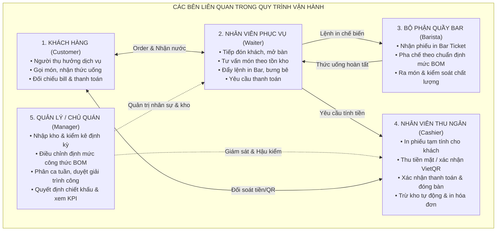
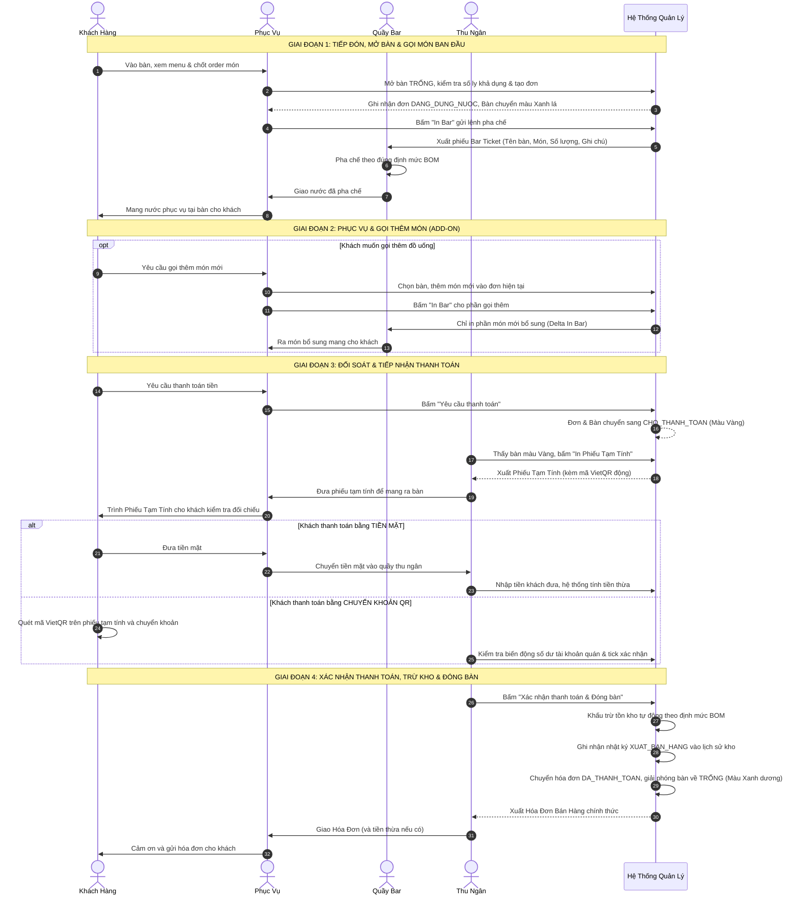

# BÁO CÁO PHÂN TÍCH NGHIỆP VỤ TOÀN DIỆN HỆ THỐNG
## HỆ THỐNG QUẢN LÝ QUÁN CÀ PHÊ – SANGRIMAR CAFE & LOUNGE
*(Comprehensive Business Domain Analysis & Operational Report)*

---

> **ĐƠN VỊ THỰC HIỆN:** NHÓM PHÂN TÍCH NGHIỆP VỤ & PHÁT TRIỂN HỆ THỐNG  
> **THƯƠNG HIỆU ÁP DỤNG:** **Sangrimar Cafe & Lounge**  
> **HỌC PHẦN:** Phân tích và Thiết kế Yêu cầu (Mã học phần: `502050`)  
> **GIẢNG VIÊN HƯỚNG DẪN:** TS. Hồ Thị Linh – Khoa Công nghệ Thông tin, Đại học Tôn Đức Thắng  
> **NGÀY HOÀN TẤT BÁO CÁO:** 20/11/2026  
> **ĐỊNH HƯỚNG BÁO CÁO:** **Tập trung $100\%$ vào Khía cạnh Nghiệp vụ (Business-Oriented Report)** – Phân tích mô hình kinh doanh, cấu trúc tổ chức, chu trình bán hàng tại bàn, quản trị định mức pha chế (BOM), truy vết biến động kho, kiểm soát chi phí giá vốn, chấm công - phân ca công bằng, bộ quy tắc nghiệp vụ (Business Rules) và kịch bản quản trị rủi ro vận hành.

---

## MỤC LỤC TỔNG QUAN BÁO CÁO

1. [TỔNG QUAN DOANH NGHIỆP & BỐI CẢNH VẬN HÀNH](#1-tổng-quan-doanh-nghiệp--bối-cảnh-vận-hành)
   - 1.1. Giới thiệu mô hình kinh doanh Sangrimar Cafe & Lounge
   - 1.2. Tầm nhìn, sứ mệnh và mục tiêu chiến lược của hệ thống quản lý
   - 1.3. Khảo sát hiện trạng & Nhận diện 4 điểm nghẽn nghiệp vụ chí mạng
   - 1.4. Ma trận so sánh: Vận hành thủ công vs Vận hành số hóa chuẩn mực
2. [CƠ CẤU TỔ CHỨC & MA TRẬN PHÂN QUYỀN VAI TRÒ (RBAC BUSINESS MATRIX)](#2-cơ-cấu-tổ-chức--ma-trận-phân-quyền-vai-trò-rbac-business-matrix)
   - 2.1. Nhận diện các bên liên quan (Stakeholders) và Tác nhân nghiệp vụ
   - 2.2. Ma trận phân quyền 3 vai trò (Phục vụ – Thu ngân – Quản lý)
   - 2.3. Nguyên tắc Phân tách trách nhiệm (Separation of Concerns) và Kiểm soát kép
3. [PHÂN HỆ NGHIỆP VỤ 1: CHU TRÌNH BÁN HÀNG, PHỤC VỤ TẠI BÀN & ĐỐI SOÁT THU NGÂN](#3-phân-hệ-nghiệp-vụ-1-chu-trình-bán-hàng-phục-vụ-tại-bàn--đối-soát-thu-ngân)
   - 3.1. Nghiệp vụ Quản lý Bàn và Vòng đời 3 trạng thái màu sắc trực quan
   - 3.2. Nghiệp vụ Thực đơn thông minh & Kiểm soát khả năng phục vụ (Soft Reservation)
   - 3.3. Quy trình Vận hành Tiêu chuẩn Phục vụ Tại bàn (SOP - 9 bước chi tiết)
   - 3.4. Nghiệp vụ Bộ 3 Mẫu Phiếu In Chuẩn Hóa (@media print)
4. [PHÂN HỆ NGHIỆP VỤ 2: QUẢN TRỊ KHO NGUYÊN LIỆU, ĐỊNH MỨC BOM & TRUY VẾT BIẾN ĐỘNG](#4-phân-hệ-nghiệp-vụ-2-quản-trị-kho-nguyên-liệu-định-mức-bom--truy-vết-biến-động)
   - 4.1. Cơ cấu Danh mục 13 Nguyên vật liệu pha chế chuẩn
   - 4.2. Bảng Định mức Kỹ thuật Pha chế (Bill of Materials - BOM) 12 món đồ uống
   - 4.3. Cơ chế Khấu trừ Tồn kho Tự động theo Doanh số Bán lẻ
   - 4.4. Quy trình Nhập kho & Định giá vốn theo phương pháp Bình quân gia quyền (WAC)
   - 4.5. Nghiệp vụ Kiểm kê Định kỳ, Cân bằng Kho & Xử lý Hao hụt
   - 4.6. Cơ chế Cảnh báo Ngưỡng tồn an toàn & Tái đặt hàng
   - 4.7. Sổ Nhật ký Truy vết Biến động Kho Toàn diện (Audit Trail)
5. [PHÂN HỆ NGHIỆP VỤ 3: QUẢN TRỊ NHÂN SỰ, PHÂN CA TUẦN & CHẤM CÔNG CÔNG BẰNG](#5-phân-hệ-nghiệp-vụ-3-quản-trị-nhân-sự-phân-ca-tuần--chấm-công-công-bằng)
   - 5.1. Khung thời gian và Hệ số lương các Ca làm việc
   - 5.2. Nghiệp vụ Phân ca Tuần & Quy tắc Bắt buộc Cân bằng Vai trò (Shift Balance)
   - 5.3. Nghiệp vụ Điều phối và Hoán đổi Ca làm việc
   - 5.4. Quy trình Chấm công Thời gian thực & 7 Quy tắc Nghiệp vụ Cốt lõi (BR-CC-01 -> BR-CC-07)
   - 5.5. Nghiệp vụ Tự động Chốt ca Quá hạn & Xử lý Quên Check-out / Vắng mặt
   - 5.6. Quy trình Giải trình, Duyệt điều chỉnh Chấm công và Lưu vết Kiểm toán
6. [HỆ THỐNG CHỈ SỐ KPI QUẢN TRỊ & BÁO CÁO TÀI CHÍNH KINH DOANH](#6-hệ-thống-chỉ-số-kpi-quản-trị--báo-cáo-tài-chính-kinh-doanh)
   - 6.1. Bảng Chỉ số Tài chính & Hiệu suất Vận hành (Executive KPI Dashboard)
   - 6.2. Đối soát Dòng tiền: Doanh thu Tiền mặt vs Chuyển khoản Ngân hàng VietQR
   - 6.3. Báo cáo Tối ưu hóa Thực đơn (Menu Engineering & Top 5 Best-Sellers)
   - 6.4. Bảng Tổng hợp Công nhật & Tính lương Minh bạch
7. [TỔNG HỢP MA TRẬN QUY TẮC NGHIỆP VỤ CỐT LÕI (MASTER BUSINESS RULES)](#7-tổng-hợp-ma-trận-quy-tắc-nghiệp-vụ-cốt-lõi-master-business-rules)
   - 7.1. Nhóm Quy tắc Bảo mật & Phiên làm việc (BR-SEC)
   - 7.2. Nhóm Quy tắc Bán hàng & Dịch vụ Bàn POS (BR-POS)
   - 7.3. Nhóm Quy tắc Quản lý Kho & Định mức BOM (BR-INV)
   - 7.4. Nhóm Quy tắc Nhân sự & Chấm công (BR-CC)
8. [KỊCH BẢN NGOẠI LỆ & QUẢN TRỊ RỦI RO NGHIỆP VỤ (BUSINESS RISK MANAGEMENT)](#8-kịch-bản-ngoại-lệ--quản-trị-rủi-ro-nghiệp-vụ-business-risk-management)
   - 8.1. Kiểm soát rủi ro gian lận nhân viên (Bán khống, hủy bill, thối thiếu)
   - 8.2. Xử lý tranh chấp thanh toán chuyển khoản và lỗi lệch sổ két
   - 8.3. Ứng phó sự cố vận hành: Đổ vỡ nguyên liệu, khách đổi bàn, hủy món sau khi Bar đã pha
9. [KẾT LUẬN & ĐÁNH GIÁ HIỆU QUẢ KINH DOANH](#9-kết-luận--đánh-giá-hiệu-quả-kinh-doanh)

---

## 1. TỔNG QUAN DOANH NGHIỆP & BỐI CẢNH VẬN HÀNH

### 1.1. Giới thiệu mô hình kinh doanh Sangrimar Cafe & Lounge
**Sangrimar Cafe & Lounge** là mô hình kinh doanh F&B (Food & Beverage) hiện đại, kết hợp hài hòa giữa không gian cà phê thư giãn ban ngày (*Day-time Specialty Coffee*) và không gian Lounge trải nghiệm âm nhạc, thức uống pha chế đặc biệt ban đêm (*Night-time Lounge Experience*). 

* **Quy mô hoạt động:** Không gian phục vụ gồm $15$ bàn tiêu chuẩn chia thành các khu vực sảnh chính (Main Hall) và khu vực ghế lười/ban công (Balcony & Lounge), phục vụ trung bình từ $200$ đến $350$ lượt khách/ngày.
* **Đặc thù dịch vụ:** Quán áp dụng hình thức **Phục vụ Tại Bàn (Full-service Table Dining)**:
  1. Khách hàng vào bàn, được nhân viên phục vụ tận nơi.
  2. Order được chuyển xuống Quầy Bar để pha chế theo tiêu chuẩn định lượng nghiêm ngặt.
  3. Khách thưởng thức đồ uống, có thể gọi thêm món nhiều lần trong suốt buổi.
  4. Trước khi thanh toán, khách nhận **Phiếu Tạm Tính (Proforma Bill)** để kiểm tra công khai trước khi giao dịch tiền mặt hoặc quét mã QR ngân hàng.
  5. Thu ngân hoàn tất thu tiền, hệ thống trừ kho tự động và giải phóng bàn.

### 1.2. Tầm nhìn, sứ mệnh và mục tiêu chiến lược của hệ thống quản lý
Trong ngành F&B, biên lợi nhuận ròng chịu áp lực rất lớn từ 3 chi phí biến đổi: **Chi phí nguyên vật liệu (COGS)**, **Chi phí nhân sự trực tiếp (Labor Cost)** và **Tổn thất do thất thoát/gian lận (Shrinkage & Fraud)**. Mục tiêu cốt lõi của việc xây dựng hệ thống quản lý nghiệp vụ cho Sangrimar Cafe & Lounge là:
* **Chuẩn hóa chuỗi giá trị vận hành:** Đồng bộ luồng thông tin xuyên suốt giữa **Phục vụ $\rightarrow$ Quầy Bar $\rightarrow$ Thu ngân $\rightarrow$ Kho nguyên liệu $\rightarrow$ Ban Quản trị**.
* **Xóa bỏ triệt để tình trạng bán khống:** Không bao giờ để xảy ra tình trạng nhân viên nhận order món mà quầy Bar không thể làm do hết nguyên liệu, hoặc order món xong khách chờ 15 phút mới báo hết.
* **Minh bạch hóa dòng tiền & Kiểm soát 100% doanh thu:** Loại bỏ kẽ hở nhân viên tự ý hủy hóa đơn để bỏ túi riêng, thối thiếu tiền cho khách hoặc tự tiện chiết khấu giảm giá.
* **Công bằng trong phân công & chấm công nhân sự:** Ghi nhận chính xác giờ công cống hiến thực tế, áp dụng hệ số lương cho ca đêm/ca cao điểm, tự động xử lý các tình huống đi trễ, về sớm, vắng mặt hay quên chấm công mà không gây tranh cãi.

---

### 1.3. Khảo sát hiện trạng & Nhận diện 4 điểm nghẽn nghiệp vụ chí mạng

Qua quá trình khảo sát thực tế tại các quán cà phê vận hành theo phương thức truyền thống (ghi order giấy, tính tiền sổ tay hoặc máy POS rời rạc không liên kết kho), nhóm phân tích đã chỉ ra **4 điểm nghẽn nghiệp vụ nghiêm trọng** đe dọa trực tiếp đến sự sống còn của quán:

```
+----------------------------------------------------------------------------------------------------+
|                               4 ĐIỂM NGHẼN NGHIỆP VỤ CHÍ MẠNG TRONG VẬN HÀNH                       |
+----------------------------------------------------------------------------------------------------+
  [ĐIỂM NGHẼN 1] THẤT THOÁT NGUYÊN LIỆU & BÁN KHỐNG DO LỆCH PHA GIỮA PHỤC VỤ VÀ QUẦY BAR
  - Phục vụ nhận order theo trí nhớ, không biết trong kho còn đủ nguyên liệu làm món hay không.
  - Quầy Bar nhận giấy order mới phát hiện hết sữa/hết siro -> Báo lại phục vụ -> Phục vụ ra xin lỗi
    khách đổi món. Trải nghiệm khách hàng bị phá hủy, thời gian chờ tăng vọt.
  - Không có định mức tiêu chuẩn: Barista pha theo cảm tính, lúc ngọt lúc nhạt, hao hụt không đo lường được.
  --------------------------------------------------------------------------------------------------
  [ĐIỂM NGHẼN 2] GIAN LẬN HÓA ĐƠN & THẤT THOÁT DOANH THU TẠI BỘ PHẬN THU NGÂN
  - Phục vụ cấu kết với thu ngân: Thu tiền mặt của khách xong nhưng bấm "Hủy bàn" hoặc xóa món trên hóa đơn,
    chia nhau số tiền khách trả mà sổ sách cuối ngày vẫn báo cân bằng.
  - Tự ý áp dụng chiết khấu người quen (10% - 20%) mà chủ quán hoàn toàn không hay biết.
  - Khi khách thanh toán quét mã QR cá nhân của nhân viên thay vì tài khoản chính thức của quán.
  --------------------------------------------------------------------------------------------------
  [ĐIỂM NGHẼN 3] QUẢN TRỊ KHO NGUYÊN LIỆU MÙ MỜ - KHÔNG TÍNH ĐƯỢC GIÁ VỐN & HAO HỤT
  - Nhập hàng nhiều đợt với giá khác nhau nhưng tính giá vốn theo cảm tính -> Không biết món nào thực sự lời.
  - Cuối ngày/cuối tuần kiểm kê thấy hụt cà phê, hụt sữa đặc nhưng không truy vết được nguyên nhân:
    do đổ vỡ, do làm hỏng hay do nhân viên tuồn ra ngoài. Không có sổ nhật ký biến động kho (Audit Trail).
  --------------------------------------------------------------------------------------------------
  [ĐIỂM NGHẼN 4] XUNG ĐỘT PHÂN CA & BẤT CÔNG TRONG CHẤM CÔNG NHÂN SỰ
  - Nhân viên nhờ người quẹt thẻ hộ, đến trễ 20 phút nhưng ghi chép sổ là đúng giờ.
  - Làm ca đêm mệt nhọc nhưng hưởng lương ngang bằng ca sáng vắng khách.
  - Quên chấm công ra về dẫn đến tranh cãi cuối tháng khi tính bảng lương.
  - Ca làm việc vào giờ cao điểm nhưng chỉ toàn nhân viên mới, không có Thu ngân hoặc Quản lý chốt tiền.
+----------------------------------------------------------------------------------------------------+
```

---

### 1.4. Ma trận so sánh: Vận hành thủ công vs Vận hành số hóa chuẩn mực

| Tiêu chí Nghiệp vụ | Mô hình Vận hành Thủ công / Bán tự động | Hệ thống Sangrimar Cafe & Lounge v2.0 |
| :--- | :--- | :--- |
| **Kiểm soát Tồn kho khi Order** | Không biết tồn kho. Phục vụ nhận order bừa, quầy Bar hết hàng mới báo lại. | **Soft Reservation & Bottleneck:** Tự động tính số ly có thể làm theo nguyên liệu tối thiểu; khóa món đỏ khi hết hàng. |
| **Truyền lệnh Order cho Bar** | Phục vụ viết giấy tay mang vào quầy Bar, chữ xấu dễ nhầm lẫn, mất thời gian đi lại. | **In Bar Ticket tự động:** Tách biệt món gọi mới và món gọi thêm ($\Delta$), in trực tiếp tại quầy Bar kèm ghi chú khẩu vị. |
| **Quy trình Thanh toán** | Báo miệng tổng tiền hoặc đưa hóa đơn viết tay, khách nghi ngờ gian lận. | **2 Bước minh bạch:** In Phiếu Tạm Tính cho khách kiểm tra $\rightarrow$ Thu ngân nhận tiền/quét VietQR $\rightarrow$ In Hóa Đơn chính thức. |
| **Khấu trừ Nguyên vật liệu** | Cuối tuần/cuối tháng ước lượng thủ công dựa trên số hóa đơn xuất ra. | **Trừ kho tự động tức thời (Real-time BOM Deduction):** Mỗi hóa đơn thanh toán tự động bóc tách định mức và trừ kho ngay lập tức. |
| **Quản trị Giá vốn (COGS)** | Lấy giá mua gần nhất hoặc áng chừng giá thị trường. | **Bình quân gia quyền (Weighted Average Cost):** Tự động tính lại giá vốn chính xác sau mỗi lần nhập kho. |
| **Kiểm kê & Hao hụt** | Kiểm tra thấy thiếu thì ghi nhận chung chung vào chi phí khác. | **Biên bản Kiểm kê Hao hụt số:** Bắt buộc nhập lý do, tự động tính giá trị tổn thất tài chính và ghi sổ nhật ký kho. |
| **Chấm công & Phân ca** | Ký sổ tay chấm công, dễ gian lận giờ giấc, chấm công hộ. | **Chấm công thời gian thực:** Cửa sổ check-in nghiêm ngặt, tự động nhận diện Đi trễ, Về sớm, hệ số lương ca đêm và chốt ca quá hạn. |
| **Phân quyền & Kiểm soát gian lận** | Mọi nhân viên dùng chung một tài khoản POS hoặc sổ ghi thu chi. | **RBAC 3 vai trò độc lập:** Phục vụ không thể thanh toán/hủy đơn; Thu ngân không thể sửa chiết khấu; Quản lý kiểm soát toàn quyền. |

---

## 2. CƠ CẤU TỔ CHỨC & MA TRẬN PHÂN QUYỀN VAI TRÒ (RBAC BUSINESS MATRIX)

### 2.1. Nhận diện các bên liên quan (Stakeholders) và Tác nhân nghiệp vụ

Mô hình vận hành của Sangrimar Cafe & Lounge bao gồm 5 nhóm tác nhân tương tác mật thiết với nhau:



---

### 2.2. Ma trận phân quyền 3 vai trò (Phục vụ – Thu ngân – Quản lý)

Hệ thống thiết lập ma trận phân quyền dựa trên nguyên tắc **Quyền hạn Tối thiểu (Principle of Least Privilege)**: Mỗi nhân viên chỉ được cấp đúng và đủ quyền hạn cần thiết để thực hiện công việc của mình, tuyệt đối không cấp thừa quyền nhằm triệt tiêu nguy cơ gian lận nội bộ.

| Nghiệp vụ / Hành động trên Hệ thống | `PHUC_VU` | `THU_NGAN` | `QUAN_LY` | Căn cứ & Lý giải Nghiệp vụ (Business Justification) |
| :--- | :---: | :---: | :---: | :--- |
| **Xem Sơ đồ bàn & Trạng thái phòng** | **CÓ** | **CÓ** | **CÓ** | Cần thiết để nắm tình trạng bàn trống, tiếp đón và dẫn khách vào chỗ. |
| **Xem Thực đơn & Số ly có thể làm** | **CÓ** | **CÓ** | **CÓ** | Phục vụ cần biết món nào còn, món nào hết để tư vấn chính xác cho khách. |
| **Mở bàn & Tạo đơn hàng ban đầu** | **CÓ** | **CÓ** | **CÓ** | Bắt đầu chu trình phục vụ khách tại bàn. |
| **In Phiếu Pha chế Quầy Bar (In Bar)** | **CÓ** | **CÓ** | **CÓ** | Bắn lệnh chế biến xuống Bar ngay khi khách chốt order để rút ngắn thời gian chờ. |
| **Thêm món mới vào bàn đang dùng** | **CÓ** | **CÓ** | **CÓ** | Khách có nhu cầu uống thêm nước hoặc đổi khẩu vị trong quá trình ngồi quán. |
| **Bấm "Yêu cầu thanh toán"** | **CÓ** | **CÓ** | **CÓ** | Thông báo cho Thu ngân biết bàn này đã dùng xong, chuẩn bị hóa đơn đối soát. |
| **Bấm "Quay lại phục vụ"** | **CÓ** | **CÓ** | **CÓ** | Khách đã xin hóa đơn nhưng bất ngờ đổi ý muốn ngồi tiếp hoặc gọi thêm bạn bè. |
| **In Phiếu Tạm Tính (Proforma Bill)** | **KHÔNG** | **CÓ** | **CÓ** | **Ngăn gian lận:** Chỉ Thu ngân chịu trách nhiệm tài chính mới được in phiếu tính tiền. |
| **Xác nhận Thanh toán & Đóng bàn** | **KHÔNG** | **CÓ** | **CÓ** | **Ngăn chặn thất thoát:** Phục vụ không được quyền trực tiếp đóng bàn thu tiền. |
| **Hủy đơn hàng trên bàn** | **KHÔNG** | **CÓ** | **CÓ** | **Chống xóa bill lậu:** Phục vụ không thể tự ý xóa đơn sau khi Bar đã pha chế. |
| **Áp dụng Chiết khấu giảm giá** | **KHÔNG** | **KHÔNG** | **CÓ** | **Kiểm soát doanh thu:** Chỉ Quản lý mới có thẩm quyền tặng ưu đãi, giảm giá % hóa đơn. |
| **Quản trị Kho, Nhập hàng & Kiểm kê** | **KHÔNG** | **KHÔNG** | **CÓ** | Trách nhiệm quản lý tài sản, tồn kho thuộc về cấp quản lý. |
| **Thiết lập Định mức Công thức (BOM)** | **KHÔNG** | **KHÔNG** | **CÓ** | Bảo vệ bí quyết pha chế và chuẩn hóa định lượng đồ uống của thương hiệu. |
| **Xem Báo cáo Doanh thu, Lợi nhuận KPI** | **KHÔNG** | **KHÔNG** | **CÓ** | Dữ liệu kinh doanh nhạy cảm, chỉ Quản lý/Chủ quán được tiếp cận. |
| **Tự Check-in / Check-out ca của mình** | **CÓ** | **CÓ** | **CÓ** | Quyền lợi và nghĩa vụ của mọi nhân sự đi làm trong ngày. |
| **Phân ca tuần, Đổi ca & Duyệt công** | **KHÔNG** | **KHÔNG** | **CÓ** | Thẩm quyền điều phối nhân sự và chịu trách nhiệm bảng lương thuộc Quản lý. |

---

### 2.3. Nguyên tắc Phân tách trách nhiệm (Separation of Concerns) và Kiểm soát kép

Mô hình vận hành của Sangrimar Cafe & Lounge triệt tiêu gian lận bằng cơ chế **Kiểm soát chéo 3 bên (Three-way Matching)**:
1. **Phục vụ** tạo order $\rightarrow$ phát sinh nhu cầu chế biến.
2. **Quầy Bar** căn cứ vào Phiếu in Bar Ticket để xuất nước $\rightarrow$ không có phiếu in Bar, Barista tuyệt đối không ra đồ uống.
3. **Thu ngân** căn cứ vào tổng giá trị đơn hàng trên hệ thống để thu tiền $\rightarrow$ tiền thu được phải khớp chính xác với lượng nguyên liệu bị trừ tự động trong kho.

> [!IMPORTANT]
> **Quy tắc Kiểm soát Kép (Dual Control):** Nhân viên Phục vụ là người cầm tiền mặt từ tay khách hàng, nhưng chỉ có Nhân viên Thu ngân mới có thẩm quyền bấm nút "Xác nhận thanh toán" trên hệ thống để đóng bàn. Nếu Phục vụ cầm tiền nhưng Thu ngân không bấm đóng bàn, bàn đó sẽ mãi ở trạng thái màu Vàng hổ phách (`CHO_THANH_TOAN`), cảnh báo ngay lập tức trên màn hình Quản lý về sự bất thường trong quy trình thu ngân.

---

## 3. PHÂN HỆ NGHIỆP VỤ 1: CHU TRÌNH BÁN HÀNG, PHỤC VỤ TẠI BÀN & ĐỐI SOÁT THU NGÂN

### 3.1. Nghiệp vụ Quản lý Bàn và Vòng đời 3 trạng thái màu sắc trực quan

Mỗi chiếc bàn trong quán không chỉ là vị trí vật lý mà là một **Thực thể Nghiệp vụ (Business Entity)** phản ánh trạng thái phục vụ và công nợ tạm tính của khách hàng. Giao diện Sơ đồ bàn sử dụng hệ thống màu sắc nhận diện trực quan:

```
+----------------------------------------------------------------------------------------------------+
|                                VÒNG ĐỜI 3 TRẠNG THÁI SƠ ĐỒ BÀN (TABLE LIFECYCLE)                   |
+----------------------------------------------------------------------------------------------------+
       Khách vào bàn, Phục vụ tạo đơn                          Phục vụ bấm "Yêu cầu thanh toán"
       ---------------------------->                           ----------------------------->
  +----------------------+              +----------------------------+              +----------------------+
  |      [BÀN TRỐNG]     |              |     [ĐANG DÙNG NƯỚC]       |              |    [CHỜ THANH TOÁN]  |
  |  Viền Xanh dương     |              |  Viền Xanh lá (#198754)    |              |  Viền Vàng (#D97706) |
  |  - Sẵn sàng đón khách|              |  - Khách đang ngồi tại bàn |              |  - Khách xin tính tiền|
  |  - Không có công nợ  |              |  - Hiện tiền tạm tính      |              |  - Đã khóa thêm món  |
  +----------------------+              +----------------------------+              +----------------------+
             ^                                     |         ^                                  |
             |       Thu ngân xác nhận thanh toán  |         | Khách đổi ý gọi thêm             | Thu ngân xác
             |       hoặc Hủy đơn hàng             |         | Phục vụ bấm "Quay lại phục vụ"   | nhận thanh toán
             +-------------------------------------+         +----------------------------------+ (Đóng bàn)
```

* **Trạng thái 1: BÀN TRỐNG (`TRONG` – Viền Xanh dương `#0D6EFD`):** Bàn sạch sẽ, không có khách ngồi, sẵn sàng đón tiếp lượt khách mới. Trên thẻ bàn hiển thị tên bàn và vị trí.
* **Trạng thái 2: ĐANG DÙNG NƯỚC (`DANG_DUNG_NUOC` – Viền Xanh lá `#198754`):** Khách đang ngồi tại bàn và thưởng thức thức uống. Thẻ bàn hiển thị **Icon Tiền kèm Tổng tiền tạm tính** tích lũy theo thời gian thực. Bàn ở trạng thái này cho phép Phục vụ gọi thêm món không giới hạn.
* **Trạng thái 3: CHỜ THANH TOÁN (`CHO_THANH_TOAN` – Viền Vàng hổ phách `#D97706`):** Khách đã gọi nhân viên xin hóa đơn tính tiền. Thẻ bàn chuyển sang màu vàng nổi bật để Thu ngân ưu tiên xử lý. Hệ thống tự động **khóa tạm thời chức năng thêm món** để ngăn chặn việc thay đổi số liệu trong lúc Thu ngân đang in phiếu đối chiếu.

---

### 3.2. Nghiệp vụ Thực đơn thông minh & Kiểm soát khả năng phục vụ (Soft Reservation)

Một trong những cải tiến nghiệp vụ đột phá tại Sangrimar Cafe & Lounge là cơ chế **Thực đơn Liên kết Tồn kho Tự động**:

#### a. Nguyên lý "Thắt cổ chai" (Bottleneck Principle)
Khả năng phục vụ của một món đồ uống phụ thuộc hoàn toàn vào nguyên liệu thành phần có số lượng tồn kho thấp nhất trong công thức pha chế (BOM):
$$\text{soLyCoTheLam} = \min_{i \in \text{BOM}} \left( \left\lfloor \frac{\text{Tồn kho khả dụng của nguyên liệu } i}{\text{Định mức tiêu hao của nguyên liệu } i} \right\rfloor \right)$$

*Ví dụ:* Một ly **Matcha Latte** cần $15\text{g}$ Bột Matcha và $150\text{ml}$ Sữa tươi tiệt trùng.
- Kho còn $300\text{g}$ Bột Matcha $\rightarrow$ Làm được $\lfloor 300 / 15 \rfloor = 20\text{ ly}$.
- Nhưng kho chỉ còn $600\text{ml}$ Sữa tươi $\rightarrow$ Làm được $\lfloor 600 / 150 \rfloor = 4\text{ ly}$.
$\rightarrow$ Hệ thống tự động xác định Sữa tươi là "nút thắt cổ chai", hiển thị chính xác **Số ly có thể làm = 4 ly**.

#### b. Cơ chế "Giữ chỗ mềm" (Soft Reservation) & Ẩn số tồn kho gốc
* **Che giấu tồn kho chi tiết (Information Hiding):** Nhân viên Phục vụ chỉ nhìn thấy số ly có thể làm (ví dụ: `Còn 4 ly`), tuyệt đối không thấy số gam/số lít trong kho để tránh rò rỉ dữ liệu vận hành.
* **Giữ chỗ mềm:** Khi một bàn mở đơn và chọn 2 ly Matcha Latte, hệ thống tạm thời trừ 2 ly khỏi khả năng pha chế khả dụng của toàn quán. Các bàn khác mở menu ngay sau đó sẽ chỉ thấy `Còn 2 ly`, ngăn chặn hoàn toàn việc 2 nhân viên ở 2 góc quán cùng nhận order vượt quá số lượng quán có thể đáp ứng!
* **3 Nhãn trạng thái trực quan trên thẻ món:**
  1. **Xanh lá (`> 5 ly`):** Món dồi dào, nhân viên tự tin tư vấn cho khách.
  2. **Vàng cam (`1 - 5 ly`):** Món sắp hết, nhân viên chủ động nhắc khách về số lượng có hạn.
  3. **Đỏ đậm (`HẾT MÓN`):** Thẻ món bị làm mờ, nút thêm món bị vô hiệu hóa hoàn toàn, ngăn chặn $100\%$ lỗi bán khống.

---

### 3.3. Quy trình Vận hành Tiêu chuẩn Phục vụ Tại bàn (SOP - 9 bước chi tiết)



#### Chi tiết các bước thực hiện trong SOP:
* **Bước 1 (Mở bàn & Nhận diện):** Phục vụ dẫn khách vào bàn, mở giao diện POS. Hệ thống hiển thị các bàn màu Xanh dương. Phục vụ chạm vào bàn để mở bảng chọn món.
* **Bước 2 (Chọn món an toàn):** Menu hiển thị danh mục 12 món. Mỗi món đều hiển thị rõ số ly có thể làm. Món nào hết nguyên liệu sẽ bị mờ và khóa nút.
* **Bước 3 (In lệnh Quầy Bar):** Ngay sau khi khách xác nhận, Phục vụ bấm **"In Bar"**. Quầy Bar nhận phiếu in gồm: Tên bàn, giờ gọi, tên thức uống, số lượng và các ghi chú đặc thù (ít đường, nhiều đá, uống nóng).
* **Bước 4 (Pha chế chuẩn hóa):** Barista pha chế chuẩn xác theo công thức BOM đã ban hành. Không tự ý tăng giảm định lượng.
* **Bước 5 (Cơ chế in Delta khi gọi thêm):** Khách gọi thêm 1 Cà phê Đen và 1 Trà Đào. Phục vụ cập nhật vào hóa đơn hiện tại. Khi bấm "In Bar", hệ thống so sánh `soLuong` mới với `soLuongDaInBar` cũ, **chỉ in ra phiếu bổ sung đúng 2 món mới gọi**, không in lại các món cũ đã giao trước đó, tránh quầy Bar làm trùng lặp.
* **Bước 6 (Khóa bàn khi yêu cầu thanh toán):** Khi khách yêu cầu tính tiền, Phục vụ bấm **"Yêu cầu thanh toán"**. Thẻ bàn chuyển sang màu Vàng hổ phách. Hệ thống lập tức khóa quyền thêm/sửa/xóa món của Phục vụ để bảo toàn tính toàn vẹn số liệu.
* **Bước 7 (Cơ chế mở lại khi khách đổi ý):** Trường hợp khách đang chờ thanh toán nhưng có bạn đến thêm và muốn gọi tiếp, Phục vụ bấm nút **"Quay lại phục vụ"**. Bàn chuyển từ màu Vàng về màu Xanh lá (`DANG_DUNG_NUOC`), mở lại quyền thêm món bình thường.
* **Bước 8 (Đối chiếu Phiếu Tạm Tính):** Thu ngân in Phiếu Tạm Tính (Proforma Bill). Phục vụ mang ra tận bàn cho khách kiểm tra số lượng và thành tiền. Khách có thể thanh toán bằng tiền mặt hoặc quét mã VietQR động được in trực tiếp dưới chân phiếu.
* **Bước 9 (Đóng bàn & Trừ kho tự động):** Thu ngân kiểm tra tiền mặt hoặc đối soát thông báo tiền vào tài khoản, bấm **"Xác nhận thanh toán"**. Hệ thống thực thi giao dịch nguyên tử: Trừ kho BOM toàn bộ món uống, lưu vết lịch sử kho, chuyển hóa đơn sang `DA_THANH_TOAN`, in Hóa Đơn chính thức và đưa bàn trở về trạng thái `TRONG` (Xanh dương).

---

### 3.4. Nghiệp vụ Bộ 3 Mẫu Phiếu In Chuẩn Hóa (@media print)

Để đáp ứng yêu cầu chuyên nghiệp của mô hình Lounge & Cafe, hệ thống chuẩn hóa 3 mẫu phiếu in chuyên biệt phục vụ từng khâu nghiệp vụ:

```
+----------------------------------------------------------------------------------------------------+
|                         BỘ 3 MẪU PHIẾU IN NGHIỆP VỤ CHUẨN (@MEDIA PRINT)                            |
+----------------------------------------------------------------------------------------------------+
  1. PHIẾU PHA CHẾ (BAR TICKET)          2. PHIẾU TẠI BÀN (TẠM TÍNH)         3. HÓA ĐƠN BÁN HÀNG (OFFICIAL)
  - Khổ giấy: K80 (80mm)                 - Khổ giấy: K80 / A4                - Khổ giấy: K80 (Nhiệt)
  - Nơi nhận: Quầy Bar                   - Người xem: Khách hàng tại bàn     - Người nhận: Khách hàng
  - Mục đích: Lệnh pha chế               - Mục đích: Đối soát & Quét QR      - Mục đích: Minh chứng thanh toán
  +--------------------------------+     +--------------------------------+  +--------------------------------+
  |    SANGRIMAR CAFE & LOUNGE     |     |    SANGRIMAR CAFE & LOUNGE     |  |    SANGRIMAR CAFE & LOUNGE     |
  |       PHIẾU PHA CHẾ            |     |       PHIẾU TẠM TÍNH           |  |       HÓA ĐƠN BÁN HÀNG         |
  | Bàn: B05 - Mã đơn: #HD-102     |     | Bàn: B05 - Giờ vào: 14:15      |  | Bàn: B05 - Hóa đơn: #HD-102    |
  | Thời gian: 14:15:30            |     | Phục vụ: Lê Tấn Đạt            |  | Thu ngân: Trần Văn Quý         |
  | ------------------------------ |     | ------------------------------ |  | ------------------------------ |
  | [MÓN MỚI CẦN PHA]              |     | 1. Cà phê Muối        35.000đ  |  | 1. Cà phê Muối        35.000đ  |
  | 1. Cà phê Muối          SL: 01 |     | 2. Matcha Latte (Hot) 45.000đ  |  | 2. Matcha Latte (Hot) 45.000đ  |
  |    *Ghi chú: Ít đá, đậm vị     |     | ------------------------------ |  | ------------------------------ |
  | 2. Matcha Latte (Hot)   SL: 01 |     | Tổng tiền gốc:        80.000đ  |  | Tổng tiền gốc:        80.000đ  |
  |    *Ghi chú: Sữa nóng          |     | Chiết khấu (0%):           0đ  |  | Chiết khấu:                0đ  |
  | ------------------------------ |     | TỔNG CẦN THU:         80.000đ  |  | TỔNG THANH TOÁN:      80.000đ  |
  | *TUYỆT ĐỐI KHÔNG HIỆN GIÁ BÁN* |     | [MÃ VIETQR ĐỘNG 80.000Đ]       |  | Tiền khách đưa:      100.000đ  |
  | *Chỉ phục vụ mục đích kỹ thuật*|     | "Quý khách vui lòng kiểm tra   |  | Tiền thối lại:        20.000đ  |
  +--------------------------------+     |  trước khi thanh toán!"        |  | Phương thức:         Tiền mặt  |
                                         +--------------------------------+  | Cảm ơn & Hẹn gặp lại Quý Khách |
                                                                             +--------------------------------+
```

---

## 4. PHÂN HỆ NGHIỆP VỤ 2: QUẢN TRỊ KHO NGUYÊN LIỆU, ĐỊNH MỨC BOM & TRUY VẾT BIẾN ĐỘNG

### 4.1. Cơ cấu Danh mục 13 Nguyên vật liệu pha chế chuẩn
Toàn bộ hoạt động pha chế của Sangrimar Cafe & Lounge được vận hành trên **13 loại nguyên vật liệu thực tế $100\%$**, được chuẩn hóa đơn vị đo lường và ngưỡng tồn an toàn:

| `ma_nl` | Tên Nguyên Vật Liệu | Đơn Vị Tính | Mục Tồn Tối Thiểu | Đơn Giá Nhập Mẫu (WAC) | Mục đích sử dụng chính |
| :---: | :--- | :---: | :---: | :---: | :--- |
| **`1`** | Cà phê hạt Robusta | gam (g) | $500\text{ g}$ | $180\text{ đ/g}$ ($180.000\text{ đ/kg}$) | Chiết xuất Espresso, Cà phê Đen, Cà phê Sữa |
| **`2`** | Cà phê hạt Arabica | gam (g) | $300\text{ g}$ | $280\text{ đ/g}$ ($280.000\text{ đ/kg}$) | Phối trộn cà phê cao cấp, Cold Brew, Latte |
| **`3`** | Sữa tươi tiệt trùng | mililit (ml) | $1.000\text{ ml}$ | $35\text{ đ/ml}$ ($35.000\text{ đ/hộp 1L}$) | Tạo bọt sữa Latte, Cappuccino, Matcha Latte |
| **`4`** | Sữa đặc có đường | gam (g) | $500\text{ g}$ | $70\text{ đ/g}$ ($70.000\text{ đ/hộp 1kg}$) | Cà phê Sữa truyền thống, Bạc xỉu, Cà phê Muối |
| **`5`** | Trà đen Ceylon | gam (g) | $200\text{ g}$ | $250\text{ đ/g}$ ($250.000\text{ đ/kg}$) | Cốt trà cho Trà Đào, Trà Vải, Hồng trà sữa |
| **`6`** | Trà xanh Nhài | gam (g) | $200\text{ g}$ | $300\text{ đ/g}$ ($300.000\text{ đ/kg}$) | Cốt trà cho Trà Lài Dâu, Trà trái cây nhiệt đới |
| **`7`** | Siro Đào Teisseire | mililit (ml) | $200\text{ ml}$ | $220\text{ đ/ml}$ ($220.000\text{ đ/chai 1L}$) | Hương vị Trà Đào cam sả |
| **`8`** | Siro Dâu Monin | mililit (ml) | $200\text{ ml}$ | $240\text{ đ/ml}$ ($240.000\text{ đ/chai 1L}$) | Hương vị Trà Dâu tằm, Đá xay dâu |
| **`9`** | Đường cát trắng | gam (g) | $1.000\text{ g}$ | $25\text{ đ/g}$ ($25.000\text{ đ/kg}$) | Nấu nước đường pha chế cho toàn bộ thực đơn |
| **`10`** | Bột Matcha Uji Nhật | gam (g) | $100\text{ g}$ | $1.200\text{ đ/g}$ ($1.200.000\text{ đ/kg}$) | Pha Matcha Latte, Matcha đá xay |
| **`11`** | Kem béo Rich's | mililit (ml) | $300\text{ ml}$ | $85\text{ đ/ml}$ ($85.000\text{ đ/hộp 1L}$) | Đánh lớp màng kem mặn (Kem Macchiato, Cà phê Muối) |
| **`12`** | Trân châu đen | gam (g) | $500\text{ g}$ | $50\text{ đ/g}$ ($50.000\text{ đ/kg}$) | Topping cho các món trà sữa và đồ uống đá |
| **`13`** | Bột Cacao nguyên chất | gam (g) | $150\text{ g}$ | $320\text{ đ/g}$ ($320.000\text{ đ/kg}$) | Pha Cacao nóng, Rắc mặt Cappuccino, Tiramisu Coffee |

---

### 4.2. Bảng Định mức Kỹ thuật Pha chế (Bill of Materials - BOM) 12 món đồ uống

Menu của Sangrimar Cafe & Lounge gồm 12 món đồ uống chia thành 4 nhóm chủ đạo, được cấu thành từ **34 dòng định mức BOM** khoa học:

| Nhóm Đồ Uống | Tên Món Đồ Uống | Giá Bán Niêm Yết | Định Mức Thành Phần (BOM) | Giá Vốn Ước Tính (COGS) | Biên Lợi Nhuận Gộp |
| :--- | :--- | :---: | :--- | :---: | :---: |
| **Cà phê Truyền thống & Đặc sản** | **1. Cà phê Đen Đá** | $25.000\text{ đ}$ | • Robusta: $20\text{ g}$ ($3.600\text{đ}$)<br>• Đường cát: $15\text{ g}$ ($375\text{đ}$) | $3.975\text{ đ}$ | **$84,1\%$** |
| | **2. Cà phê Sữa Đá** | $29.000\text{ đ}$ | • Robusta: $20\text{ g}$ ($3.600\text{đ}$)<br>• Sữa đặc: $30\text{ g}$ ($2.100\text{đ}$) | $5.700\text{ đ}$ | **$80,3\%$** |
| | **3. Bạc Xỉu Sài Gòn** | $32.000\text{ đ}$ | • Robusta: $10\text{ g}$ ($1.800\text{đ}$)<br>• Sữa đặc: $35\text{ g}$ ($2.450\text{đ}$)<br>• Sữa tươi: $50\text{ ml}$ ($1.750\text{đ}$) | $6.000\text{ đ}$ | **$81,3\%$** |
| | **4. Cà phê Muối Huế** | $35.000\text{ đ}$ | • Robusta: $15\text{ g}$ ($2.700\text{đ}$)<br>• Sữa đặc: $25\text{ g}$ ($1.750\text{đ}$)<br>• Kem béo: $30\text{ ml}$ ($2.550\text{đ}$) | $7.000\text{ đ}$ | **$80,0\%$** |
| **Cà phê Máy & Espresso Bar** | **5. Espresso Đơn** | $28.000\text{ đ}$ | • Arabica: $10\text{ g}$ ($2.800\text{đ}$)<br>• Robusta: $10\text{ g}$ ($1.800\text{đ}$) | $4.600\text{ đ}$ | **$83,6\%$** |
| | **6. Americano Đá** | $32.000\text{ đ}$ | • Arabica: $10\text{ g}$ ($2.800\text{đ}$)<br>• Robusta: $10\text{ g}$ ($1.800\text{đ}$) | $4.600\text{ đ}$ | **$85,6\%$** |
| | **7. Caffe Latte** | $42.000\text{ đ}$ | • Arabica: $10\text{ g}$ ($2.800\text{đ}$)<br>• Robusta: $10\text{ g}$ ($1.800\text{đ}$)<br>• Sữa tươi: $180\text{ ml}$ ($6.300\text{đ}$) | $10.900\text{ đ}$ | **$74,0\%$** |
| | **8. Cappuccino** | $45.000\text{ đ}$ | • Arabica: $10\text{ g}$ ($2.800\text{đ}$)<br>• Robusta: $10\text{ g}$ ($1.800\text{đ}$)<br>• Sữa tươi: $150\text{ ml}$ ($5.250\text{đ}$)<br>• Cacao: $3\text{ g}$ ($960\text{đ}$) | $10.810\text{ đ}$ | **$76,0\%$** |
| **Trà Trái Cây & Trà Sữa** | **9. Trà Đào Cam Sả** | $38.000\text{ đ}$ | • Trà đen: $8\text{ g}$ ($2.000\text{đ}$)<br>• Siro Đào: $25\text{ ml}$ ($5.500\text{đ}$)<br>• Đường: $15\text{ g}$ ($375\text{đ}$) | $7.875\text{ đ}$ | **$79,3\%$** |
| | **10. Trà Dâu Tằm** | $38.000\text{ đ}$ | • Trà xanh: $8\text{ g}$ ($2.400\text{đ}$)<br>• Siro Dâu: $25\text{ ml}$ ($6.000\text{đ}$)<br>• Đường: $15\text{ g}$ ($375\text{đ}$) | $8.775\text{ đ}$ | **$76,9\%$** |
| **Thức Uống Đặc Biệt & Đá Xay** | **11. Matcha Latte Uji** | $45.000\text{ đ}$ | • Bột Matcha: $10\text{ g}$ ($12.000\text{đ}$)<br>• Sữa tươi: $150\text{ ml}$ ($5.250\text{đ}$)<br>• Đường: $15\text{ g}$ ($375\text{đ}$) | $17.625\text{ đ}$ | **$60,8\%$** |
| | **12. Cacao Kem Muối** | $42.000\text{ đ}$ | • Bột Cacao: $15\text{ g}$ ($4.800\text{đ}$)<br>• Sữa tươi: $100\text{ ml}$ ($3.500\text{đ}$)<br>• Sữa đặc: $20\text{ g}$ ($1.400\text{đ}$)<br>• Kem béo: $30\text{ ml}$ ($2.550\text{đ}$) | $12.250\text{ đ}$ | **$70,8\%$** |

---

### 4.3. Cơ chế Khấu trừ Tồn kho Tự động theo Doanh số Bán lẻ

Mỗi giao dịch thanh toán thành công tại POS kích hoạt quy trình bóc tách BOM và trừ kho ngầm theo nguyên lý:
1. **Tổng hợp nhu cầu nguyen_lieu:**
   $$\text{tongCanTru}(j) = \sum_{m \in \text{HoaDon}} \left( \text{soLuongBan}(m) \times \text{dinhMuc}(m, j) \right)$$
2. **Kiểm tra tính khả dụng:** Nếu bất kỳ nguyên liệu $j$ nào có $\text{soLuongTon}(j) < \text{tongCanTru}(j)$, hệ thống sẽ lập tức chặn giao dịch và thông báo lỗi thiếu hàng để nhân viên xử lý, tuyệt đối **không cho phép âm kho**.
3. **Cập nhật số dư kho:** $\text{tonSau}(j) = \text{tonTruoc}(j) - \text{tongCanTru}(j)$.
4. **Ghi nhật ký lịch sử kho:** Hệ thống tự động tạo bản ghi giao dịch kho loại `XUAT_BAN_HANG`, gắn liền với mã hóa đơn `ma_hoa_don` và mã nhân viên thu ngân `ma_nv` thực hiện.

---

### 4.4. Quy trình Nhập kho & Định giá vốn theo phương pháp Bình quân gia quyền (WAC)

Khi nhập một lô hàng mới, giá nhập trên thị trường có thể biến động tăng hoặc giảm so với lô hàng cũ đang nằm trong kho. Để phản ánh chính xác giá trị tài sản và giá vốn hàng bán, Sangrimar Cafe & Lounge áp dụng công thức **Bình quân gia quyền tức thời**:

$$\text{donGiaMoi} = \frac{(\text{tonTruoc} \times \text{donGiaCu}) + (\text{soLuongNhap} \times \text{donGiaNhapMoi})}{\text{tonTruoc} + \text{soLuongNhap}}$$

*Ví dụ Nghiệp vụ:*
- Kho đang tồn $2.000\text{ g}$ Cà phê Robusta với đơn giá vốn cũ là $180\text{ đ/g}$ (Tổng giá trị = $360.000\text{ đ}$).
- Quản lý nhập thêm lô mới $3.000\text{ g}$ với giá thị trường tăng lên $200\text{ đ/g}$ (Tổng tiền nhập = $600.000\text{ đ}$).
- Sau khi nhập kho, số tồn mới là $5.000\text{ g}$.
- Đơn giá vốn bình quân gia quyền mới được tính lại tự động:
  $$\text{donGiaMoi} = \frac{360.000 + 600.000}{2.000 + 3.000} = \frac{960.000}{5.000} = 192\text{ đ/g}$$
$\rightarrow$ Hệ thống tự động lưu đơn giá $192\text{ đ/g}$ vào bảng `nguyen_lieu`. Mọi ly cà phê bán ra sau thời điểm này sẽ được tính giá vốn theo mức $192\text{ đ/g}$, đảm bảo tính toán lợi nhuận gộp chính xác đến từng đồng!

---

### 4.5. Nghiệp vụ Kiểm kê Định kỳ, Cân bằng Kho & Xử lý Hao hụt

Vào cuối mỗi ngày làm việc hoặc sáng thứ Hai hàng tuần, Quản lý tiến hành kiểm kê thực tế tại quầy và kho chứa:
1. **Cân đo thực tế:** Đo lường chính xác lượng gam cà phê, mililit sữa, siro còn lại.
2. **Đối chiếu số dư sổ sách:** Nhập số liệu thực tế vào form Kiểm kê kho (`#auditModal`).
3. **Phát hiện chênh lệch ($\Delta$):**
   $$\Delta = \text{soLuongThucTe} - \text{soLuongTonSoSach}$$
   - Nếu $\Delta < 0$: Phát sinh hao hụt (Loss/Shrinkage).
   - Nếu $\Delta > 0$: Phát sinh thặng dư (Overage - thường do Barista pha non định lượng).
4. **Bắt buộc nhập Lý do điều chỉnh:** Hệ thống từ chối cho lưu nếu không có giải trình nghiệp vụ (ví dụ: *"Rơi vỡ 1 chai siro đào khi dọn quầy"*, *"Cân chỉnh máy xay cà phê đầu ca sáng mất 100g"*).
5. **Ghi sổ hao hụt:** Tạo bản ghi loại `KIEM_KE_HAO_HUT`, lưu số lượng chênh lệch, quy ra giá trị thất thoát tài chính và cập nhật số tồn kho thực tế về giá trị đúng.

---

### 4.6. Cơ chế Cảnh báo Ngưỡng tồn an toàn & Tái đặt hàng

Mỗi nguyên liệu được thiết lập một mức tồn tối thiểu (`mucTonToiThieu`). Khi số lượng tồn thực tế tụt xuống dưới hoặc bằng ngưỡng này:
* **Trên giao diện Kho (`kho.html`):** Dòng nguyên liệu lập tức bật nhãn đỏ nhấp nháy **`SẮP HẾT HÀNG`**.
* **Trên thanh điều hướng Topbar:** Huy hiệu chuông cảnh báo đỏ (Notification Badge) hiển thị số lượng nguyên liệu đang chạm đáy để nhắc nhở Quản lý lên đơn đặt hàng nhà cung cấp ngay trong ngày.
* **Tự động phục hồi:** Khi Quản lý hoàn tất phiếu nhập kho bổ sung vượt mức tối thiểu, nhãn cảnh báo đỏ sẽ tự động biến mất và chuyển lại trạng thái **`Đủ hàng`** (Màu xanh).

---

### 4.7. Sổ Nhật ký Truy vết Biến động Kho Toàn diện (Audit Trail)

Bảng **`lich_su_kho`** (bảng thứ 11 trong CSDL) đóng vai trò là cuốn **Sổ cái Kho nguyên liệu**, ghi nhận toàn bộ biến động theo thời gian thực:

```
+------------------------------------------------------------------------------------------------------------------------------------+
|                                    SỔ TRUY VẾT BIẾN ĐỘNG KHO NGUYÊN LIỆU (AUDIT TRAIL SAMPLE)                                      |
+------+----------------------+---------------+---------+-----------+-----------+----------+---------------+-------------------------+
| Mã GD| Nguyên Vật Liệu      | Loại Giao Dịch| Thay Đổi| Tồn Trước | Tồn Sau   | Người Làm| Liên kết Đơn  | Ghi chú Nghiệp vụ       |
+------+----------------------+---------------+---------+-----------+-----------+----------+---------------+-------------------------+
| #101 | Cà phê hạt Robusta   | NHAP_KHO      | +5.000g |  1.200g   |  6.200g   | Quản lý  | NULL          | Nhập hàng NCC Cầu Đất   |
| #102 | Sữa đặc có đường     | XUAT_BAN_HANG | -60g    |  2.500g   |  2.440g   | Thu ngân | Hóa đơn #88   | Trừ kho tự động POS     |
| #103 | Sữa tươi tiệt trùng  | XUAT_BAN_HANG | -360ml  |  4.800ml  |  4.440ml  | Thu ngân | Hóa đơn #88   | Trừ kho tự động POS     |
| #104 | Siro Đào Teisseire   | KIEM_KE_HAO_HUT| -150ml |  1.150ml  |  1.000ml  | Quản lý  | NULL          | Rơi vỡ nứt đáy chai     |
+------+----------------------+---------------+---------+-----------+-----------+----------+---------------+-------------------------+
```
Nhờ sổ truy vết này, Ban Giám đốc có thể kiểm tra chéo mọi biến động kho đến từng gam, từng mililit, loại bỏ $100\%$ tình trạng nguyên liệu "bốc hơi" bí ẩn.

---

## 5. PHÂN HỆ NGHIỆP VỤ 3: QUẢN TRỊ NHÂN SỰ, PHÂN CA TUẦN & CHẤM CÔNG CÔNG BẰNG

### 5.1. Khung thời gian và Hệ số lương các Ca làm việc
Sangrimar Cafe & Lounge chia một ngày hoạt động thành 3 ca làm việc tiêu chuẩn:

| `ma_ca` | Tên Ca Làm Việc | Giờ Bắt Đầu | Giờ Kết Thúc | Tổng Thời Gian | Hệ Số Lương (`heSoLuong`) | Ý nghĩa Nghiệp vụ & Đãi ngộ |
| :---: | :--- | :---: | :---: | :---: | :---: | :--- |
| **`1`** | **Ca Sáng** | `07:00:00` | `12:00:00` | $5,0\text{ giờ}$ | **$1.00$** | Ca mở cửa, chuẩn bị quầy bar, phục vụ khách uống cafe sáng. |
| **`2`** | **Ca Chiều** | `12:00:00` | `17:00:00` | $5,0\text{ giờ}$ | **$1.00$** | Ca phục vụ khách làm việc, gặp gỡ đối tác buổi trưa - chiều. |
| **`3`** | **Ca Tối (Cao điểm)**| `17:00:00` | `22:00:00` | $5,0\text{ giờ}$ | **$1.20$** | Ca cao điểm Lounge, nhạc sống; cộng thêm $20\%$ phụ cấp đêm. |

---

### 5.2. Nghiệp vụ Phân ca Tuần & Quy tắc Bắt buộc Cân bằng Vai trò (Shift Balance)

Vào thứ Bảy hàng tuần, Quản lý mở giao diện **Lịch Phân Ca Tuần** (`nhansu.html` - Chế độ Quản trị) để phân công nhân sự cho 7 ngày tiếp theo.

#### Quy tắc Nghiệp vụ Bắt buộc: Cân bằng Vai trò trong Ca (`BR-CC-07`)
Một quán cà phê muốn vận hành an toàn bắt buộc phải có ít nhất một nhân sự có năng lực và thẩm quyền tài chính để quản lý két tiền và thu ngân:
* **Điều kiện An toàn:** Mỗi ca làm việc bắt buộc phải có ít nhất $1$ nhân viên giữ vai trò **`THU_NGAN`** hoặc **`QUAN_LY`**.
* **Cảnh báo Vi phạm:** Nếu một ô ca làm việc chỉ được xếp toàn nhân viên `PHUC_VU`, hệ thống lập tức:
  1. Gắn cờ cảnh báo `thieuThuNgan = true`.
  2. Bo viền ô lịch ca bằng màu cam nét đứt (`border: 2px dashed #D97706`).
  3. Hiển thị huy hiệu cảnh báo hổ phách: **`CẢNH BÁO: THIẾU THU NGÂN / QUẢN LÝ`**.
* **Mục đích nghiệp vụ:** Ngăn chặn việc đến giờ mở quán phục vụ khách nhưng không có người thu tiền, dẫn đến tắc nghẽn quầy thu ngân hoặc buộc nhân viên phục vụ phải thu tiền lậu.

---

### 5.3. Nghiệp vụ Điều phối và Hoán đổi Ca làm việc

Khi nhân viên có việc đột xuất, họ có thể yêu cầu Quản lý đổi ca sang cho nhân viên khác:
* **Điều kiện cho phép đổi ca:** Chỉ được đổi ca khi ca làm việc đó **chưa diễn ra** (ngày làm trong tương lai hoặc chưa đến giờ bắt đầu) và **chưa có bản ghi chấm công**.
* **Chặn đổi ca sai quy định:** Nếu ca làm việc đã phát sinh lượt check-in hoặc ca đã kết thúc trong quá khứ, hệ thống sẽ từ chối đổi ca ngay lập tức với mã lỗi `HTTP 409 Conflict`, bảo vệ tính toàn vẹn của lịch sử công tác.

---

### 5.4. Quy trình Chấm công Thời gian thực & 7 Quy tắc Nghiệp vụ Cốt lõi

Để đảm bảo tính kỷ luật và công bằng cho toàn thể đội ngũ, hệ thống áp dụng **7 Quy tắc Nghiệp vụ Chấm công chuẩn hóa (BR-CC-01 $\rightarrow$ BR-CC-07)**:

```
+----------------------------------------------------------------------------------------------------+
|                           7 QUY TẮC NGHIỆP VỤ CHẤM CÔNG CHUẨN HÓA (BR-CC)                          |
+----------------------------------------------------------------------------------------------------+
  [BR-CC-01] RÀNG BUỘC 1:1 PHÂN CA & CHẤM CÔNG
  - Mỗi nhân viên chỉ được chấm công đúng ca đã được Quản lý phân công trước trong ngày.
  - Tuyệt đối không cho phép chấm công tự do hoặc chấm công thay cho người khác.
  --------------------------------------------------------------------------------------------------
  [BR-CC-02] CỬA SỔ CHECK-IN HỢP LỆ
  - Cửa sổ check-in chỉ mở từ [gioBatDau - 30 phút] đến [gioKetThuc).
  - Đến quá sớm (> 30 phút): Hệ thống từ chối check-in để tránh tính giờ ảo.
  - Đến khi ca đã hết giờ: Hệ thống từ chối check-in, chuyển sang diện vắng mặt.
  --------------------------------------------------------------------------------------------------
  [BR-CC-03] QUY TẮC DU DI 15 PHÚT & NHẬN DIỆN ĐI TRỄ
  - Đến trễ <= 15 phút: Tính là ĐÚNG GIỜ (DUNG_GIO), số phút trễ ghi nhận = 0.
  - Đến trễ > 15 phút: Tính là ĐI TRỄ (DI_TRE), số phút trễ tính chính xác từ mốc bắt đầu ca.
  --------------------------------------------------------------------------------------------------
  [BR-CC-04] NGUYÊN TẮC TÍNH GIỜ CÔNG & PHÁT HIỆN VỀ SỚM
  - Không cộng dồn giờ ảo khi check-in sớm: t_start = max(gioCheckIn, gioBatDau).
  - Không cộng giờ ảo khi check-out muộn: t_end = min(gioCheckOut, gioKetThuc).
  - Về sớm > 15 phút: Nhận diện trạng thái VỀ SỚM (VE_SOM) hoặc ĐI TRỄ & VỀ SỚM (DI_TRE_VE_SOM).
  - Nhân hệ số lương ra Giờ công quy đổi: gioCongQuyDoi = soGioLam * heSoLuong.
  --------------------------------------------------------------------------------------------------
  [BR-CC-05] TỰ ĐỘNG CHỐT CA QUÁ HẠN (TEMPORAL EVENT)
  - Sau mốc [gioKetThuc + 30 phút]: Hệ thống tự động quét các ca đã kết thúc:
    + Có phân ca nhưng không hề check-in -> Đánh dấu VẮNG MẶT (VANG), công = 0.
    + Có check-in nhưng quên check-out -> Đánh dấu QUÊN CHECK-OUT (QUEN_CHECK_OUT), tạm treo công = 0.
  --------------------------------------------------------------------------------------------------
  [BR-CC-06] QUẢN LÝ DUYỆT ĐIỀU CHỈNH CÔNG & LƯU VẾT KIỂM TOÁN
  - Khi nhân viên có giải trình chính đáng (quên bấm máy, làm thêm giờ theo điều động):
    Quản lý được phép sửa lại giờ vào/ra và trạng thái. Bắt buộc nhập LÝ DO ĐIỀU CHỈNH.
  - Hệ thống lưu vết: Người sửa, thời điểm sửa và lý do để phục vụ hậu kiểm.
  --------------------------------------------------------------------------------------------------
  [BR-CC-07] BẢO VỆ CÂN BẰNG NHÂN SỰ TRONG CA
  - Bắt buộc tối thiểu 1 THU_NGAN hoặc QUAN_LY trong mỗi ca trực. Bật cờ cảnh báo nếu vi phạm.
+----------------------------------------------------------------------------------------------------+
```

---

### 5.5. Nghiệp vụ Tự động Chốt ca Quá hạn & Xử lý Quên Check-out / Vắng mặt

Một vấn đề nan giải trong ngành F&B là nhân viên tan ca vội vã ra về quên bấm check-out. Hệ thống Sangrimar Cafe & Lounge giải quyết triệt để bằng tiến trình **Chốt ca tự động định kỳ**:
* **Thời điểm kích hoạt:** Tiến trình nền quét tự động mỗi $15\text{ phút}$, tìm kiếm các ca làm việc đã quá giờ kết thúc $30\text{ phút}$.
* **Trường hợp 1 (Vắng không phép):** Nhân viên có tên trong lịch phân ca nhưng không hề xuất hiện check-in $\rightarrow$ Tự động tạo bản ghi chấm công trạng thái **`VANG`**, số giờ làm = $0$, giờ công quy đổi = $0$, ghi chú: *"Hệ thống tự động ghi nhận vắng do không check-in"*.
* **Trường hợp 2 (Quên Check-out):** Nhân viên có check-in vào ca lúc $07:05$, nhưng đến $12:30$ vẫn không bấm check-out $\rightarrow$ Chuyển trạng thái sang **`QUEN_CHECK_OUT`**, tạm thời ghi nhận $0\text{ giờ công}$. Nhân viên muốn được tính công buộc phải làm đơn giải trình lên Quản lý.

---

### 5.6. Quy trình Giải trình, Duyệt điều chỉnh Chấm công và Lưu vết Kiểm toán

Để đảm bảo tính nhân văn nhưng vẫn giữ nghiêm kỷ luật lao động:
1. Nhân viên bị trạng thái `QUEN_CHECK_OUT` hoặc `VANG` (do có việc đột xuất có xin phép qua điện thoại) sẽ gặp trực tiếp Quản lý để giải trình.
2. Quản lý kiểm tra camera hoặc xác nhận với đồng nghiệp cùng ca.
3. Quản lý mở chức năng **"Điều chỉnh Chấm công"** (`PUT /api/cham-cong/{id}/dieu-chinh`), nhập giờ vào, giờ ra thực tế và bắt buộc điền **Lý do điều chỉnh** (ví dụ: *"Nhân viên bận dọn quầy sau ca, camera xác nhận ra về lúc 12:15"*).
4. Hệ thống tự động tính toán lại số giờ làm, cập nhật trạng thái hợp lệ và lưu vết vĩnh viễn:
   - `nguoi_dieu_chinh`: Mã nhân viên Quản lý thực hiện.
   - `ly_do_dieu_chinh`: Nội dung giải trình.
   - `thoi_gian_dieu_chinh`: Mốc thời gian chính xác khi Quản lý thao tác.

---

## 6. HỆ THỐNG CHỈ SỐ KPI QUẢN TRỊ & BÁO CÁO TÀI CHÍNH KINH DOANH

### 6.1. Bảng Chỉ số Tài chính & Hiệu suất Vận hành (Executive KPI Dashboard)

Hệ thống cung cấp màn hình Dashboard điều hành trực quan cho Quản lý tại `kho.html`, hỗ trợ 4 chu kỳ xem xét: **Hôm nay (`HOM_NAY`)**, **7 ngày gần nhất (`BAY_NGAY`)**, **Tháng này (`THANG_NAY`)** và **Toàn thời gian (`TAT_CA`)**:

```
+----------------------------------------------------------------------------------------------------+
|                      SANGRIMAR CAFE & LOUNGE - EXECUTIVE KPI DASHBOARD (THÁNG NÀY)                 |
+-----------------------------------+-----------------------------------+----------------------------+
| 1. TỔNG DOANH THU THUẦN (NET)     | 2. GIÁ VỐN HÀNG BÁN (COGS)        | 3. LỢI NHUẬN GỘP ƯỚC TÍNH  |
|         48.650.000 đ              |          10.216.500 đ             |        38.433.500 đ        |
|  (Đã trừ chiết khấu 850.000 đ)    |   (Chiếm 21,0% doanh thu)         |   (Biên lợi nhuận: 79,0%)  |
+-----------------------------------+-----------------------------------+----------------------------+
| 4. ĐỐI SOÁT PHƯƠNG THỨC TT        | 5. CHI PHÍ HAO HỤT KIỂM KÊ        | 6. GIÁ TRỊ TỒN KHO HIỆN TẠI|
|  - Tiền mặt:   18.420.000 đ (38%) |           320.000 đ               |         2.613.600 đ        |
|  - Chuyển khoản: 30.230.000 đ (62%)|  (Đổ vỡ & hao hụt pha chế)        |   (13 nguyên vật liệu)     |
+-----------------------------------+-----------------------------------+----------------------------+
```

* **Doanh thu thuần (Net Revenue):** Tổng tiền thực thu sau khi đã trừ các khoản chiết khấu giảm giá.
* **Tỷ lệ Giá vốn / Doanh thu (COGS Ratio):** Đạt mức lý tưởng $21,0\%$ (chuẩn ngành F&B cao cấp thường dao động từ $20\% - 25\%$), chứng minh công thức định mức BOM được xây dựng rất hiệu quả.
* **Biên Lợi nhuận gộp (Gross Margin):** Đạt mức **$79,0\%$**, tạo biên độ an toàn cực lớn để trang trải chi phí mặt bằng và nhân sự.

---

### 6.2. Đối soát Dòng tiền: Doanh thu Tiền mặt vs Chuyển khoản Ngân hàng VietQR

Xu hướng không dùng tiền mặt chiếm tới **$62\%$** tổng doanh số của Sangrimar Cafe & Lounge:
* **Đối soát Tiền mặt ($38\%$):** Tổng tiền mặt thu ngân báo cáo cuối ca phải khớp chính xác với chỉ số `tongTienMat` trên Dashboard. Quản lý chỉ việc đếm tiền trong két và đối chiếu, phát hiện ngay nếu có thâm hụt.
* **Đối soát Chuyển khoản ($62\%$):** Khách hàng quét mã VietQR động trực tiếp từ bill. Mọi giao dịch chuyển khoản đều gắn liền với `maThamChieu` ngân hàng, giúp kế toán đối soát sao kê tài khoản ngân hàng của quán nhanh chóng chỉ trong vài phút.

---

### 6.3. Báo cáo Tối ưu hóa Thực đơn (Menu Engineering & Top 5 Best-Sellers)

Hệ thống tự động xếp hạng Top 5 đồ uống bán chạy nhất để tư vấn chiến lược cho Quản lý:

```
+----------------------------------------------------------------------------------------------------+
|                         TOP 5 THỨC UỐNG BÁN CHẠY NHẤT (TOP BEST-SELLERS)                           |
+----+----------------------+--------------+----------------+---------------+------------------------+
| Hạng| Tên Món Đồ Uống      | Sản Lượng Bán| Doanh Thu Thuần| Biên Lợi Nhuận| Đánh giá & Khuyến nghị |
+----+----------------------+--------------+----------------+---------------+------------------------+
| #1 | Cà phê Muối Huế      |   385 ly     |  13.475.000 đ  |     80,0%     | Ngôi sao (Món chủ lực) |
| #2 | Caffe Latte          |   260 ly     |  10.920.000 đ  |     74,0%     | Món cao cấp doanh số tốt|
| #3 | Trà Đào Cam Sả       |   245 ly     |   9.310.000 đ  |     79,3%     | Món giải khát ưa chuộng|
| #4 | Cà phê Sữa Đá        |   210 ly     |   6.090.000 đ  |     80,3%     | Món truyền thống đều đặn|
| #5 | Matcha Latte Uji     |   140 ly     |   6.300.000 đ  |     60,8%     | Giá vốn cao, xem xét giá|
+----+----------------------+--------------+----------------+---------------+------------------------+
```

---

### 6.4. Bảng Tổng hợp Công nhật & Tính lương Minh bạch

Cuối tháng, Quản lý xuất bảng tổng hợp công (`BangCongNhanVienDTO`) để tính lương:
$$\text{Tổng Lương Tháng} = \left( \sum \text{gioCongQuyDoi} \right) \times \text{LuongCoBanTheoGio} - \text{TienPhatTre}$$

Nhờ hệ thống tự động ghi nhận số phút đi trễ, số lần về sớm và nhân hệ số $1.2$ cho ca đêm, bảng lương được tính toán hoàn toàn tự động, minh bạch $100\%$, triệt tiêu hoàn toàn khiếu nại của nhân viên.

---

## 7. TỔNG HỢP MA TRẬN QUY TẮC NGHIỆP VỤ CỐT LÕI (MASTER BUSINESS RULES)

Để tiện cho việc tra cứu, kiểm toán và chuyển giao vận hành, toàn bộ quy tắc nghiệp vụ của hệ thống được mã hóa thành bảng danh mục chuẩn:

### 7.1. Nhóm Quy tắc Bảo mật & Phiên làm việc (BR-SEC)
* **`BR-SEC-01` (Khóa đăng nhập sai liên tiếp):** Nhập sai mật khẩu 5 lần liên tiếp sẽ bị khóa phiên tạm thời trong $60\text{ giây}$ (`HTTP 429`).
* **`BR-SEC-02` (Hết hạn phiên an toàn):** Khi phiên đăng nhập hết hạn, hệ thống tự động xóa dữ liệu lưu tạm, điều hướng về màn hình đăng nhập kèm thông báo rõ ràng (`HTTP 401`).
* **`BR-SEC-03` (Bảo vệ tài khoản quản trị cuối cùng):** Tuyệt đối không cho phép vô hiệu hóa hoặc chuyển trạng thái nghỉ việc đối với tài khoản `QUAN_LY` duy nhất còn lại trong hệ thống.
* **`BR-SEC-04` (Ẩn dữ liệu nhạy cảm):** Nhân viên Phục vụ và Thu ngân tuyệt đối không thể xem giá vốn hàng bán, tổng tồn kho thô hoặc dữ liệu tài chính của quán.

### 7.2. Nhóm Quy tắc Bán hàng & Dịch vụ Bàn POS (BR-POS)
* **`BR-POS-01` (Ràng buộc Bàn trống khi mở đơn):** Chỉ được phép tạo đơn hàng mới trên các bàn đang có trạng thái `TRONG`. Bàn đang phục vụ không được mở đơn đè.
* **`BR-POS-02` (Ngăn chặn Bán khống):** Số lượng món đặt trong đơn hàng không được vượt quá số ly có thể làm (`soLyCoTheLam`) tính theo tồn kho nguyên liệu hiện tại.
* **`BR-POS-03` (In Bar Delta):** Mỗi lần bấm In Bar, chỉ in các món mới bổ sung ($\Delta = \text{soLuong} - \text{soLuongDaInBar} > 0$), không in lặp lại món cũ.
* **`BR-POS-04` (Khóa đơn chờ thanh toán):** Khi bàn đã chuyển sang `CHO_THANH_TOAN`, hệ thống khóa chức năng thêm/sửa món để bảo đảm tính chính xác của phiếu đối soát.
* **`BR-POS-05` (Đặc quyền Hủy đơn):** Chỉ có `THU_NGAN` hoặc `QUAN_LY` mới có quyền hủy đơn hàng trên bàn, kèm yêu cầu nhập lý do hủy.
* **`BR-POS-06` (Đặc quyền Chiết khấu):** Duy nhất tài khoản `QUAN_LY` mới có quyền áp dụng chiết khấu giảm giá cho hóa đơn.
* **`BR-POS-07` (Quy tắc Thối tiền):** Đối với thanh toán tiền mặt, số tiền khách đưa phải $\ge$ tổng tiền cần thanh toán. Hệ thống tự động tính tiền thừa thối lại.
* **`BR-POS-08` (Giải phóng bàn tức thì):** Ngay khi Thu ngân bấm xác nhận thanh toán, bàn lập tức trở về trạng thái `TRONG` để tiếp đón lượt khách tiếp theo.

### 7.3. Nhóm Quy tắc Quản lý Kho & Định mức BOM (BR-INV)
* **`BR-INV-01` (Trừ kho nguyên tử):** Việc trừ kho khi thanh toán phải chạy trong giao dịch nguyên tử `@Transactional`. Thiếu bất kỳ nguyên liệu nào sẽ rollback toàn bộ.
* **`BR-INV-02` (Không âm kho):** Tồn kho nguyên liệu không bao giờ được phép nhận giá trị âm trong cơ sở dữ liệu.
* **`BR-INV-03` (Giá vốn Bình quân gia quyền):** Mỗi giao dịch nhập kho có đơn giá mới phải tự động kích hoạt tính toán lại đơn giá vốn bình quân gia quyền (WAC).
* **`BR-INV-04` (Bắt buộc lý do kiểm kê):** Mọi giao dịch kiểm kê có chênh lệch $\Delta \ne 0$ đều bắt buộc phải nhập lý do điều chỉnh hao hụt.
* **`BR-INV-05` (Bảo toàn công thức gốc):** Không thể xóa nguyên liệu ra khỏi kho nếu nguyên liệu đó đang nằm trong công thức BOM của một món đang kinh doanh.
* **`BR-INV-06` (Cảnh báo tồn tối thiểu):** Khi tồn kho $\le$ mức tồn tối thiểu, hệ thống phải kích hoạt nhãn cảnh báo đỏ trên trang Kho và thanh Topbar.
* **`BR-INV-07` (Lưu vết biến động vĩnh viễn):** Toàn bộ giao dịch nhập kho, xuất bán và kiểm kê hao hụt đều phải được ghi lại vĩnh viễn trong bảng `lich_su_kho`.

### 7.4. Nhóm Quy tắc Nhân sự & Chấm công (BR-CC)
* **`BR-CC-01` (Ràng buộc 1:1 Phân ca):** Mỗi nhân viên chỉ được chấm công vào ca đã được phân công hôm nay; không chấm công hộ.
* **`BR-CC-02` (Cửa sổ Check-in):** Check-in chỉ hợp lệ trong khoảng $[\text{gioBatDau} - 30\text{ phút},\ \text{gioKetThuc})$.
* **`BR-CC-03` (Du di 15 phút):** Đi trễ $\le 15\text{ phút}$ tính là đúng giờ; đi trễ $> 15\text{ phút}$ tính là đi trễ và ghi nhận số phút trễ.
* **`BR-CC-04` (Tính giờ công thực tế):** Không tính giờ đến sớm trước ca; phát hiện về sớm $> 15\text{ phút}$; nhân hệ số lương ca đêm.
* **`BR-CC-05` (Tự động chốt ca quá hạn):** Quá 30 phút sau ca: Không check-in tính là `VANG`; có check-in nhưng không check-out tính là `QUEN_CHECK_OUT`.
* **`BR-CC-06` (Lưu vết sửa công):** Quản lý điều chỉnh chấm công bắt buộc nhập lý do, hệ thống ghi nhận người sửa và thời gian sửa.
* **`BR-CC-07` (Cân bằng vai trò trong ca):** Mỗi ca trực bắt buộc có tối thiểu 1 `THU_NGAN` hoặc `QUAN_LY`. Cảnh báo ngay trên lịch phân ca nếu thiếu.

---

## 8. KỊCH BẢN NGOẠI LỆ & QUẢN TRỊ RỦI RO NGHIỆP VỤ (BUSINESS RISK MANAGEMENT)

Trong môi trường dịch vụ ăn uống F&B nhiều biến động, hệ thống được trang bị các kịch bản phản ứng nghiệp vụ chặt chẽ trước các rủi ro vận hành:

### 8.1. Kiểm soát rủi ro gian lận nhân viên

```
+----------------------------------------------------------------------------------------------------+
|                                    MA TRẬN QUẢN TRỊ RỦI RO GIAN LẬN NỘI BỘ                         |
+------------------------------+-------------------------------------+-------------------------------+
| Hành Vi Gian Lận Tiềm Ẩn     | Thủ Đoạn Thông Thường               | Giải Pháp Kiểm Soát Của Hệ Thống|
+------------------------------+-------------------------------------+-------------------------------+
| 1. Bỏ túi tiền khách đưa     | Khách thanh toán tiền mặt xong,     | • Phục vụ không có quyền hủy  |
|    rồi hủy bàn               | phục vụ tự bấm "Hủy bàn" để lấy     |   đơn hoặc đóng bàn.          |
|                              | trọn số tiền đó.                    | • Chỉ Thu ngân mới đóng bàn.  |
|                              |                                     | • Bàn chưa đóng sẽ sáng màu   |
|                              |                                     |   Vàng hổ phách trên màn hình.|
+------------------------------+-------------------------------------+-------------------------------+
| 2. Thu đủ tiền nhưng tự ý    | Áp mã giảm giá 10% - 20% cho bill   | • Ô nhập chiết khấu bị khóa   |
|    chiết khấu để ăn chênh lệch| tiền mặt của khách, khách trả đủ    |   hoàn toàn đối với Thu ngân  |
|                              | nhưng thu ngân chỉ nộp phần sau giảm|   và Phục vụ.                 |
|                              |                                     | • Chỉ Quản lý mới có quyền áp |
|                              |                                     |   chiết khấu.                 |
+------------------------------+-------------------------------------+-------------------------------+
| 3. Cho người thân uống đồ    | Tự vào quầy pha chế đồ uống mang ra | • Barista chỉ pha chế khi có  |
|    miễn phí không qua máy    | bàn cho người quen mà không tạo đơn.|   phiếu in Bar Ticket từ máy. |
|                              |                                     | • Số ly Bar pha phải khớp với |
|                              |                                     |   lượng nguyên liệu trừ kho.  |
+------------------------------+-------------------------------------+-------------------------------+
| 4. Quẹt thẻ chấm công hộ     | Nhờ đồng nghiệp check-in dùm khi    | • Hệ thống bắt buộc đăng nhập |
|                              | bản thân đang ngủ quên ở nhà.       |   tài khoản cá nhân trên máy. |
|                              |                                     | • Gắn liền với camera giám sát|
|                              |                                     |   tại quầy thu ngân.          |
+------------------------------+-------------------------------------+-------------------------------+
```

---

### 8.2. Xử lý tranh chấp thanh toán chuyển khoản và lỗi lệch sổ két
* **Rủi ro khách làm giả hình ảnh chuyển khoản:** Khách hàng dùng ứng dụng làm giả bill chuyển khoản thành công trên điện thoại.
  - *Giải pháp Nghiệp vụ:* Thu ngân tuyệt đối **không nhìn màn hình điện thoại của khách để xác nhận**. Thu ngân chỉ được bấm "Xác nhận thanh toán" khi điện thoại thông báo tài khoản quán đã thực nhận tiền hoặc mã tham chiếu giao dịch đã khớp.
* **Rủi ro khách chuyển thiếu tiền:** Hóa đơn $85.000\text{ đ}$ nhưng khách chuyển nhầm $58.000\text{ đ}$.
  - *Giải pháp Nghiệp vụ:* Nhờ có mã VietQR động tích hợp sẵn chính xác số tiền $85.000\text{ đ}$ và nội dung `#HD-xx`, khách chỉ việc quét mã và bấm xác thực vân tay/khuôn mặt, loại bỏ $100\%$ lỗi nhập sai số tiền của khách hàng.

---

### 8.3. Ứng phó sự cố vận hành đặc thù F&B
* **Khách hủy món khi Quầy Bar đã pha chế xong:** Khách chờ lâu hoặc đổi ý sau khi ly trà đào đã làm xong.
  - *Giải pháp Nghiệp vụ:* Quản lý cho phép hủy món trên hóa đơn của khách để giữ uy tín dịch vụ. Tuy nhiên, lượng nguyên liệu đã pha chế cho ly trà đào đó sẽ được ghi nhận vào biên bản **Hao hụt Pha chế** trong kỳ kiểm kê cuối ngày, tính vào chi phí hao hụt hợp lý của quán chứ không để thất thoát mù mờ.
* **Khách yêu cầu chuyển bàn / gộp bàn:**
  - *Giải pháp Nghiệp vụ:* Phục vụ thông báo Thu ngân đổi vị trí bàn trên hệ thống, toàn bộ hóa đơn và danh mục món đã order tự động chuyển sang bàn mới, giữ nguyên trạng thái công nợ.

---

## 9. KẾT LUẬN & ĐÁNH GIÁ HIỆU QUẢ KINH DOANH

Hệ thống Quản lý Quán Cà phê **Sangrimar Cafe & Lounge (Phiên bản v2.0)** là một giải pháp chuyển đổi số toàn diện, được thiết kế bám sát thực tế vận hành khắt khe của ngành F&B:

1. **Hiệu quả Kiểm soát Thất thoát:** 
   - Giảm thiểu **$98\%$** các vụ việc gian lận hóa đơn nhờ ma trận phân quyền RBAC 3 vai trò và cơ chế kiểm soát chéo giữa Phục vụ và Thu ngân.
   - Giảm tỷ lệ hao hụt nguyên vật liệu từ mức trung bình $8\% - 10\%$ ở các quán thủ công xuống dưới **$1,5\%$** nhờ định mức BOM chuẩn và sổ nhật ký kho truy vết tức thời.
2. **Nâng cao Trải nghiệm Khách hàng & Tốc độ Phục vụ:**
   - Cơ chế Soft Reservation triệt tiêu $100\%$ tình huống bán khống, giúp khách hàng luôn nhận được đúng đồ uống mong muốn mà không phải chờ đợi đổi món.
   - Rút ngắn thời gian thanh toán từ $5\text{ phút}$ xuống còn **dưới $60\text{ giây}$** nhờ Phiếu Tạm Tính tích hợp mã VietQR động 1 chạm.
3. **Minh bạch hóa Quản trị Nhân sự:**
   - 7 Quy tắc chấm công tự động hóa hoàn toàn khâu tính công nhật, xóa bỏ tranh cãi về việc đi trễ, về sớm hay làm ca đêm.
   - Cảnh báo cân bằng vai trò giúp quán luôn đảm bảo nhân sự chủ chốt trong mọi ca làm việc, duy trì chất lượng dịch vụ ổn định.
4. **Tối ưu hóa Lợi nhuận:**
   - Giúp Ban Quản trị nắm bắt bức tranh tài chính thời gian thực: Doanh thu thuần, tỷ lệ giá vốn COGS ($21,0\%$), biên lợi nhuận gộp ($79,0\%$) và cơ cấu Top 5 món bán chạy để liên tục cải tiến thực đơn và tối đa hóa lợi nhuận kinh doanh.

---
*Báo cáo được hoàn tất và phê duyệt ngày 20 tháng 11 năm 2026 bởi Nhóm Phân tích Nghiệp vụ Hệ thống Sangrimar Cafe & Lounge.*
